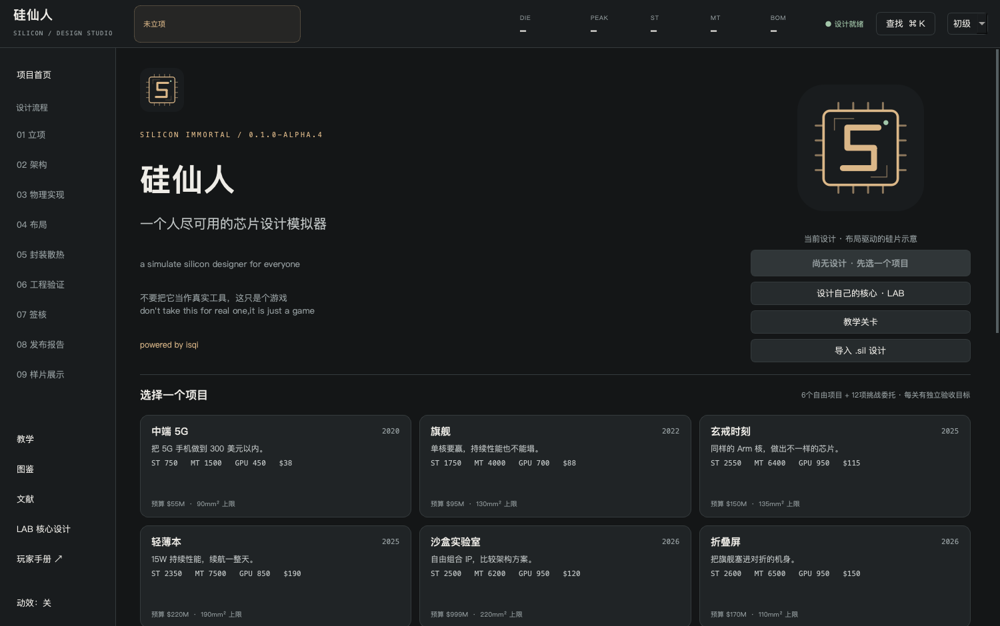
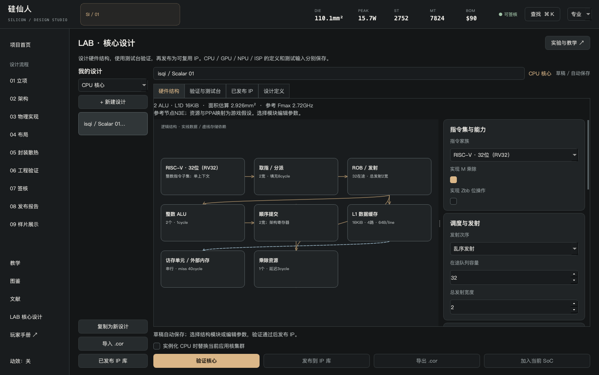
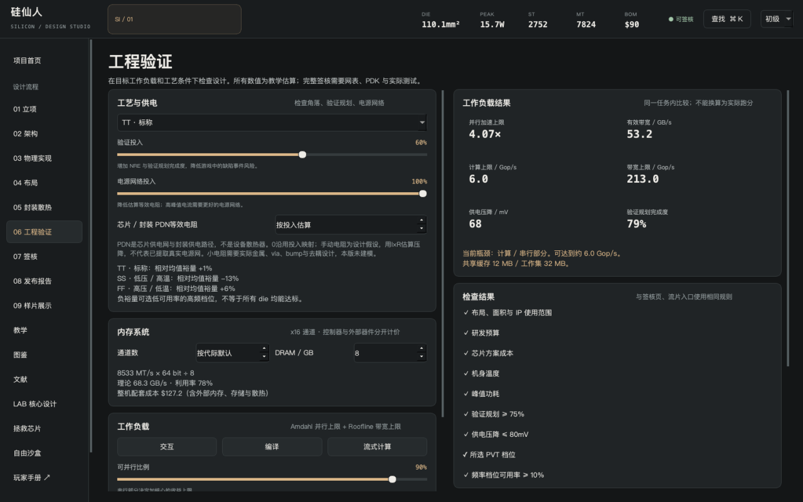
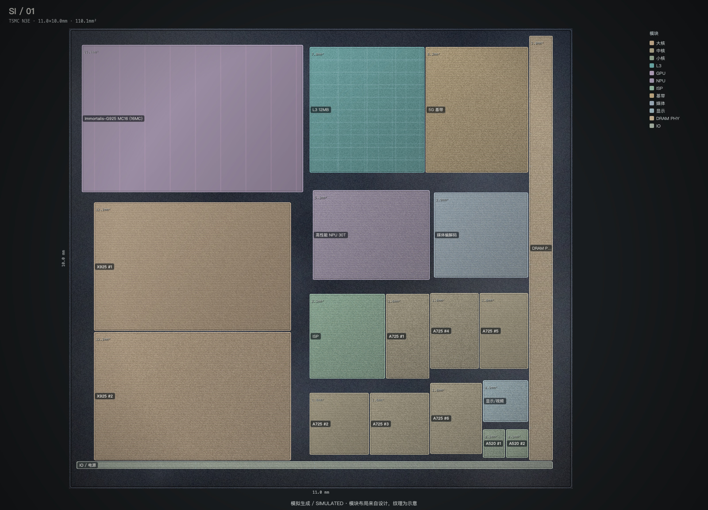

<div align="center">


# 硅仙人 · Silicon Immortal

**一个人尽可用的芯片设计模拟器**

a simulate silicon designer for everyone

[下载发行版](https://github.com/qi-1021/silicon-immortal/releases) · [玩家手册](docs/guide/README.md) · [问题反馈](https://github.com/qi-1021/silicon-immortal/issues)


powered by isqi

</div>



设计自己的CPU、GPU、NPU和ISP，使用实际输入检查功能与资源周期，发布为IP，再将它们组成SoC。选择制程、缓存、布局与封装，承担功耗、成本、流片和上市结果。

> don't take this for real one,it is just a game
> 不要把它当作真实工具，这只是个游戏。PPA与签核是教学估算；模拟硅片图不是实物显微照片。

## 为什么做这个游戏

这是一个最好的时代，每个人都可以获取自己想要的知识。这也是一个最坏的时代，因为每个人都装作自己什么都明白。

在观看芯片分析的时候，我常常看到一些人认为，像玄戒那样使用公版架构的芯片，设计难度很低。我不是相关专业的学生，但我知道事情不可能这么简单：芯片设计与拼图之间，差距很大。因此，我把想法告诉了模型，做出了这个游戏。希望各位游玩愉快。

—— isqi

## 下载与脚本启动

当前发行仅提供源码ZIP和启动脚本，不提供exe/app。先安装Python3.12，再从[Releases](https://github.com/qi-1021/silicon-immortal/releases)下载SiliconImmortal-source.zip并完整解压。

| 平台 | 启动脚本 | 要求 |
| --- | --- | --- |
| Windows | 双击run.bat | Windows10/11 x64，Python3.12 |
| Mac | 双击run.command，或终端./run.command | macOS14+，Python3.12；Intel/M系列均可 |

首次启动在本项目创建.venv并联网安装PySide6，后续游戏可离线运行。源码Release附图文离线手册：浏览器打开docs/player-guide/index.html；直接克隆仓库也可阅读docs/guide/README.md。具体Python安装、脚本权限与排障见[安装指南](docs/guide/install.md)。

## 从核心开始



LAB默认是核心设计台，课程位于“实验与教学”。无需先建SoC，直接新建、命名、复制四类核心草稿。结构图来自当前硬件定义，点击模块定位参数；验证后发布、导出.cor或用于开放核心挑战/研究沙盒。

| 设计对象 | 能决定的硬件 | 能观察的结果 |
| --- | --- | --- |
| CPU | 三种整数ISA子集、RV32 M/Zbb、顺序/乱序、队列、ALU/乘除资源、cache几何/延迟 | 寄存器、编码、动态依赖与提交时序 |
| GPU | SIMT处理器、lane、驻留warp、ALU延迟、发射间隔、时钟/带宽 | FP32逐lane结果、分歧路径与资源周期 |
| NPU | 阵列、INT8/16、累加器位宽、scratchpad、时钟/带宽 | GEMM、tile占用、有限整数溢出与周期 |
| ISP | 黑电平/增益/去马赛克/gamma旁路、并行度、行缓冲、量化 | RAW/RGB测试图像、像素输出与周期 |

x86提供单发射顺序、双发射顺序和四发射乱序三个教学模板，架构页可载入LAB编辑完整硬件；工作站项目可直接使用。x86表示Intel/AMD广为使用的指令家族，目前执行32位IA-32整数子集，尚无x86-64、SSE/AVX或OS。

硬件与测试台分开保存；修改测试输入不改变核心身份，硬件修改使旧验证失效。性能测试提供独立吞吐、依赖链、缓存重用和乘法四类任务，逐项IPC与基线对照；短程序不敏感时不会人为改分。发布IP是不可变快照，不会随草稿修改偷偷改变原SoC。详见[第一颗核心](docs/guide/first-core.md)与[加速器设计](docs/guide/accelerators.md)。

## 19个项目，32节课程

7个自由产品项目覆盖中端5G、旗舰、先进节点、轻薄本、折叠屏、x86工作站和研究沙盒。新增12项挑战委托，每关有明确目标、实时检查、操作提示和可运行参考方案：

| 工程挑战 | 产品挑战 | 核心挑战 |
| --- | --- | --- |
| 不赌频率档位 | 把热预算还给机身 | 自己的顺序核心 |
| 内存墙前的编译农场 | 开放指令集的迁移账单 | 相机里的两种算力 |
| 串行代码的逆袭 | 给封装留一毫米 | 用驻留隐藏等待 |
| 两颗Die的一张账单 | 先进节点没有产能 | |
| | 售价不替你省成本 | |

通关要求项目验收与教学签核同时通过，市场随机事件不决定委托是否完成。所有初始方案需要调整，12份参考.sil已实际重放验收。攻略逐项列出论文/手册的定位、核验状态、支持与不支持的范围。

[12项委托攻略](docs/guide/challenges.md) · [可直接导入的设计](docs/examples/README.md)

14节产品设计课与18节进阶实验课互补，含观察目标、参考解和原文。初级/中级/高级/专业模式控制提示与参数展开，底层规则相同。CPU历史目录35项，只有RV32I/M/Zbb、IA-32、AArch64三个明确整数子集可运行；未实现项不能当作执行器。

## 从SoC到样片



九阶段工作台：立项→架构→物理实现→布局→封装/散热→工程验证→签核→报告→样片。工作负载分析包含Amdahl与Roofline，签核共用预算、成本、温度、功耗、验证、PDN、PVT和分档检查。



成品展示按玩家布局生成模拟硅片、300mm晶圆和功能布局，可缩放、平移和导出PNG。不存在与玩家设计无关的真实参考照片；所有图明确标记模拟生成。

## 文件与分享

`.cor`保存单个核心/IP。`.sil`保存完整SoC：自定义核心的硬件与名称、模板核心的全参数与参考制程、实例数量/频率/L2/实现和布局。接收者只收.sil也能恢复，无需额外本地IP库。

导入优先使用文件模板，缺失定义、类别不符或摘要损坏明确报错；不信任附带分数。游戏、格式和模型版本分别记录，版本数字不同不单独阻止读取。公式更新仍可能改变重算估计。

[导出、备份与分享](docs/guide/sharing.md) · [格式说明](docs/FORMAT.md)

## 玩家文档

| 内容 | 文档 |
| --- | --- |
| 安装、首启、系统提示 | [安装指南](docs/guide/install.md) |
| CPU设计、验证、发布 | [第一颗核心](docs/guide/first-core.md) |
| SoC九阶段 | [第一颗SoC](docs/guide/soc.md) |
| 关卡与参考方案 | [委托攻略](docs/guide/challenges.md) |
| GPU/NPU/ISP | [加速器设计](docs/guide/accelerators.md) |
| 导入导出、存档、更新 | [文件与分享](docs/guide/sharing.md) |
| 失败原因与反馈 | [常见问题](docs/guide/faq.md) |
| 术语与模型解释 | [词汇表](docs/guide/glossary.md) |

## 联系与改进

欢迎通过[邮箱](mailto:qiisme1021@gmail.com)、[Pull Request](https://github.com/qi-1021/silicon-immortal/pulls)或[Issue](https://github.com/qi-1021/silicon-immortal/issues)联系我，我看到了都会回应。

如果你指出了难以操作、不合常理的设计，而且确有改进之处，我会修正。如果制作过程中遗漏了影响芯片设计的重要变量，也请积极指出。我会优先处理描述明确、能够复现，或有明确论文依据的问题。引用资料时，最好附上标题、链接和具体章节，方便一起核对。

或许未来某一天，当芯片可以被“打印”时，会有人用这个“游戏”设计芯片。当然，现在它只是个游戏。这是一份愿景，当前版本并不具备制造芯片的能力。

## 科学边界与开发

本作已实现功能解释器、资源调度和可解释SoC估算，仍没有完整CPU微架构、玩家逻辑门/RTL生成、商业GPU栈、PDK、真实STA/DRC/LVS/DFT或制造流程。固定验证不等于完整ISA或硬件认证；面积、Fmax、功耗、良率和市场系数仍为game_assumption。

正式来源23条区分正文与书目核验，99条遗留引用逐项处置；不会用“有论文”替代参数校准。Murphy具体良率公式仍未由原文确认。PicoRV32真实源码以固定提交和ISC许可保留，独立Icarus冒烟只验证ADDI/ADDI/SW写入42，未把它当玩家生成RTL或PPA校准。

[模型公式](docs/MODEL.md) · [来源与支持范围](docs/REFERENCES.md) · [审查](docs/AUDIT.md) · [第三方许可](THIRD_PARTY_NOTICES.md)

```bash
# 已安装依赖的Python环境
python tools/test.py
python tools/export_examples.py
python tools/export_challenges.py
python tools/export_lab_manual.py
python tools/capture_screens.py
# 发行/手册构建需 requirements-docs.txt
python tools/build_manual.py
python tools/source_release.py
```

GitHub Actions分别在Windows x64、Mac arm64和Mac x64运行全套测试与图文手册检查，只发布源码和脚本。当前版本与发布内容见[发行说明](docs/RELEASE_NOTES.md)。

本作采用MIT，第三方维持原许可。GitHub为主仓库；[code.qiisme1021.space镜像](https://code.qiisme1021.space/isqi/silicon-immortal)同步代码，问题反馈集中到GitHub。
