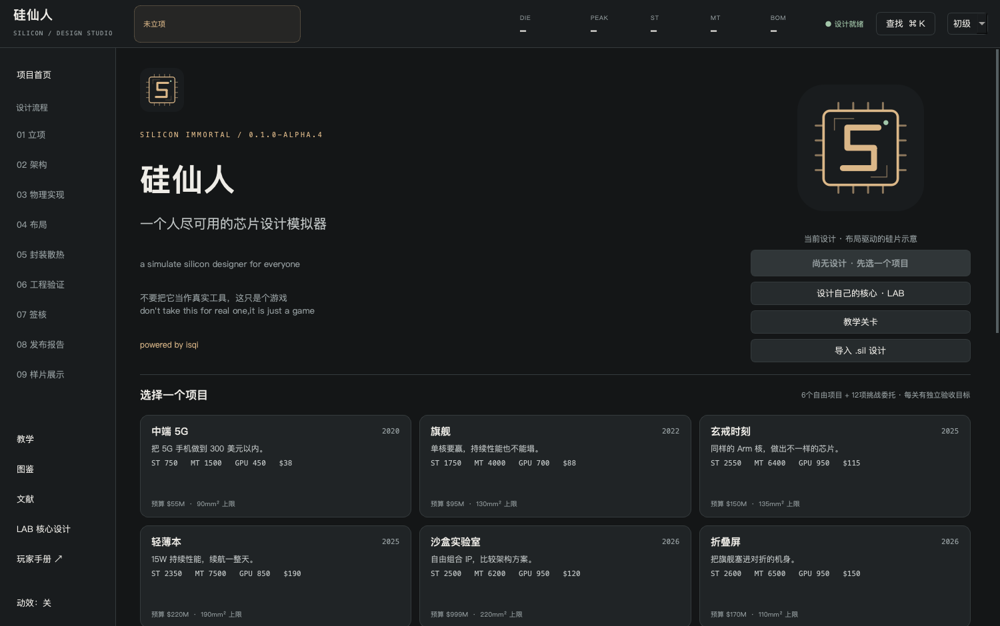
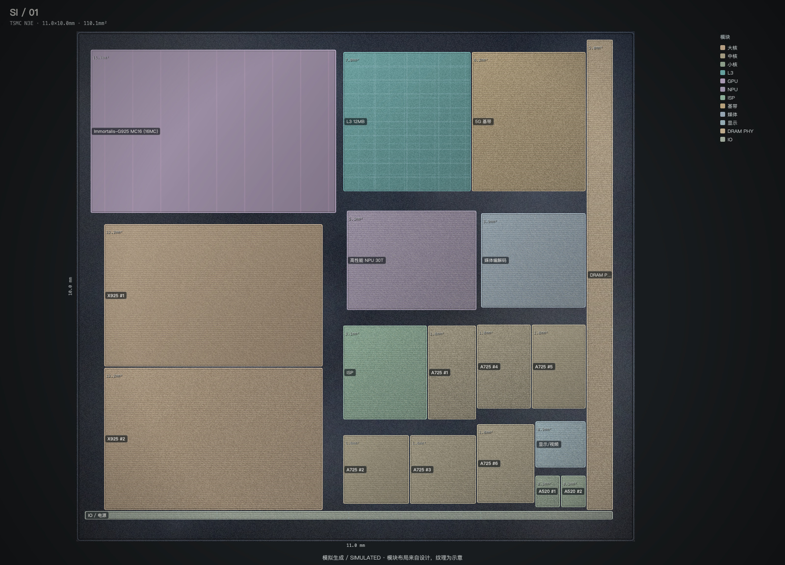

# 硅仙人 · 玩家手册

源码发行：Windows用run.bat，Mac用run.command；需Python3.12，首次自动安装依赖。

**从第一颗核心到一份可以分享的芯片设计。** 当前发行：`0.1.0-alpha.4`。

硅仙人是单机芯片设计游戏。你可以从CPU、GPU、NPU或ISP核心开始，也可以直接选择产品项目，完成架构、制程、缓存、布局、封装、工程检查和上市评估。核心设计与SoC设计可以互相连接：发布自己的IP，把它放进SoC，再用完整`.sil`文件分享。

> 本作的指令语义、资源调度与SoC估算处于不同层次。它是游戏，不是制造芯片或完成真实EDA签核的工具。图中的硅片纹理也是按玩家布局生成的模拟图。

## 为什么做这个游戏

这是一个最好的时代，每个人都可以获取自己想要的知识。这也是一个最坏的时代，因为每个人都装作自己什么都明白。

在观看芯片分析的时候，我常常看到一些人认为，像玄戒那样使用公版架构的芯片，设计难度很低。我不是相关专业的学生，但我知道事情不可能这么简单：芯片设计与拼图之间，差距很大。因此，我把想法告诉了模型，做出了这个游戏。希望各位游玩愉快。

—— isqi

## 从这里开始

| 你想做什么 | 阅读位置 |
| --- | --- |
| 安装Python、用Windows或Mac脚本启动 | [安装与启动](install.md) |
| 从零设计一个自己的CPU | [第一颗核心](first-core.md) |
| 完成架构、布局、封装与流片 | [第一颗SoC](soc.md) |
| 挑战带宽、热、成本与核心设计 | [12项设计委托](challenges.md) |
| 设计GPU、NPU和ISP | [加速器设计](accelerators.md) |
| 保存、导出、导入与分享 | [文件、备份与分享](sharing.md) |
| 无法启动、签核失败或结果不理解 | [常见问题](faq.md) |
| 理解IPC、ROB、SIMT、TOPS等术语 | [术语与模型边界](glossary.md) |

## 三条游玩路线

**第一次接触芯片：** 选择初级模式，先完成产品设计教学，再做“售价不替你省成本”或“给封装留一毫米”。初级模式折叠专家参数，但保持相同计算规则。

**想设计自己的核心：** 首页“设计自己的核心 · LAB”→新建CPU→命名→选择模块→验证→发布→研究沙盒/核心挑战复用。课程在右上角“实验与教学”，随时可用于查概念与做对照。

**想研究系统瓶颈：** 从“内存墙前的编译农场”“串行代码的逆袭”“用驻留隐藏等待”开始。先固定工作负载，再改变硬件，读计算上限、带宽上限和实际资源周期。

## 界面里哪些数字可以直接比较

- **同一核心、同一输入的周期：** 用于比较本作资源调度方案。
- **同一SoC模型、同一工作负载的估算：** 用于观察面积、功耗、吞吐和成本之间的取舍。
- **跨ISA的IPC、GPU不同单元数量、AI综合分：** 没有统一真实能力单位，不能直接拿来排名实物芯片。
- **签核通过：** 表示游戏规则通过，不代表STA/DRC/LVS通过。
- **通关：** 新挑战要求项目验收全部满足并通过教学签核；商业评分另行记录。

第一次不必追求满分。先把一个选择的原因、代价和验证结果讲清楚，再复制设计做第二版。

## 联系与改进

欢迎通过[邮箱](mailto:qiisme1021@gmail.com)、[Pull Request](https://github.com/qi-1021/silicon-immortal/pulls)或[Issue](https://github.com/qi-1021/silicon-immortal/issues)联系我，我看到了都会回应。

如果你指出了难以操作、不合常理的设计，而且确有改进之处，我会修正。如果制作过程中遗漏了影响芯片设计的重要变量，也请积极指出。我会优先处理描述明确、能够复现，或有明确论文依据的问题。引用资料时，最好附上标题、链接和具体章节，方便一起核对。

或许未来某一天，当芯片可以被“打印”时，会有人用这个“游戏”设计芯片。当然，现在它只是个游戏。这是一份愿景，当前版本并不具备制造芯片的能力。
