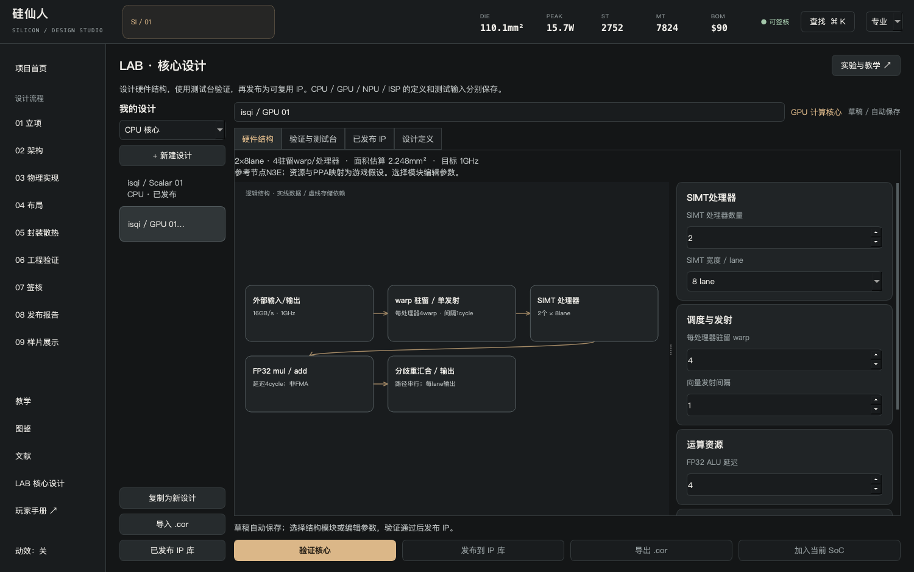
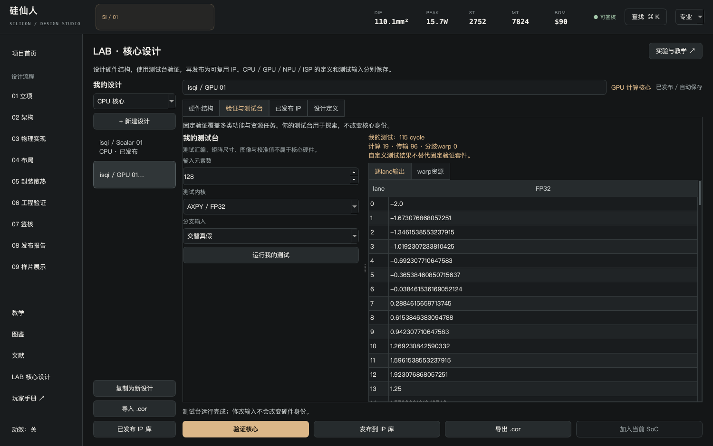
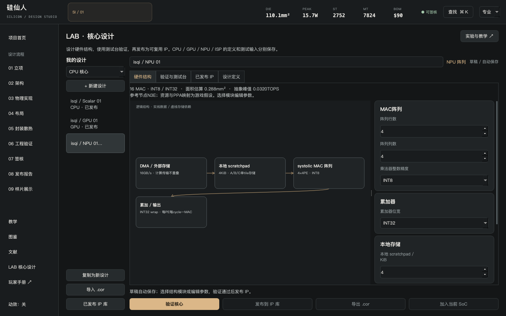
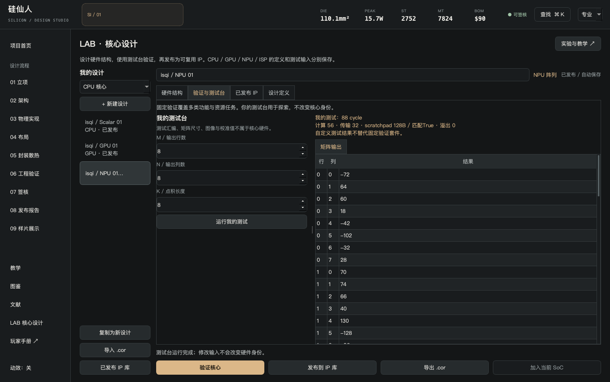
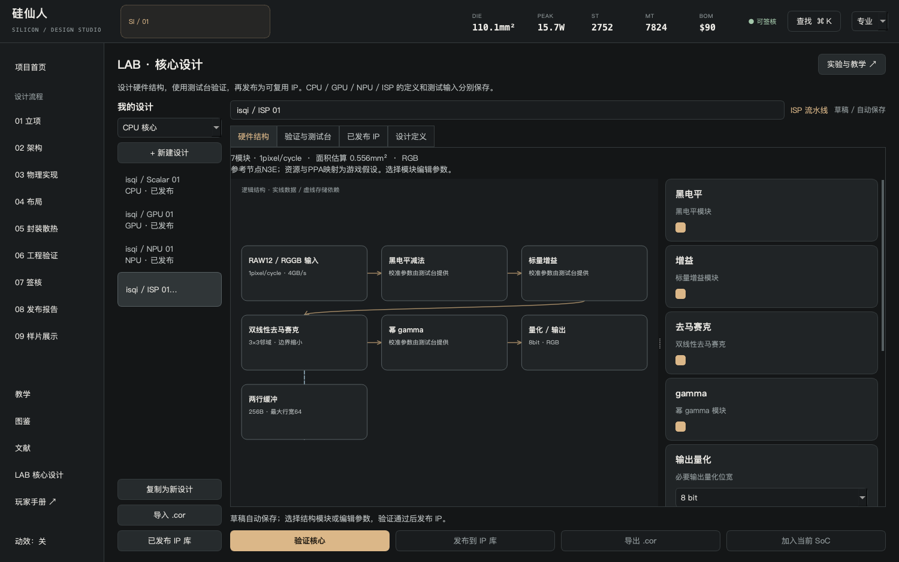
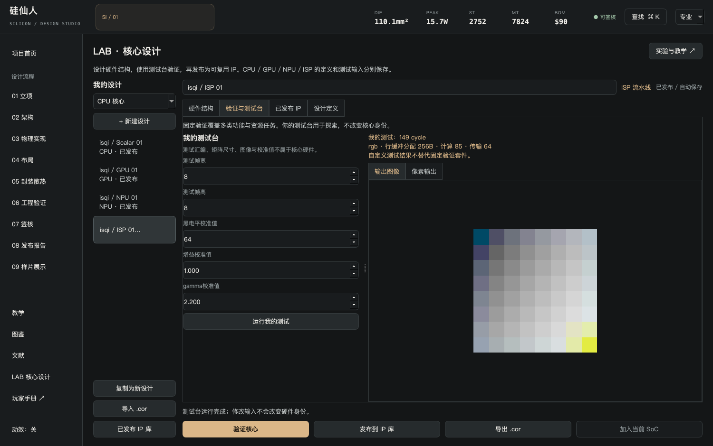

# GPU、NPU与ISP设计

三类核心都遵循同一流程：硬件草稿→固定验证→自己的测试→发布IP→用于SoC。它们的任务和资源模型不同，不能用同一分数代替实际定义。

## GPU：SIMT计算核心

| 参数 | 影响 |
| --- | --- |
| SIMT处理器 | 可以独立安排warp的处理器数量 |
| lane宽度 | 每条向量执行的lane数，未满warp也占一个warp |
| 驻留warp | 独立warp交错发射，可隐藏指定运算延迟 |
| FP32 ALU延迟 | 结果就绪时间；不是实际电路关键路径 |
| 发射间隔 | 每处理器两次向量发射之间的间隔 |
| 时钟/带宽 | 计算速率与输入输出传输耗时 |

测试台有AXPY和条件分支；分支输入可以全部为真或交替真假。FP32乘与加分别舍入，没有FMA融合；分歧路径串行执行。

做“用驻留隐藏等待”挑战：2处理器、8-lane、ALU延迟8，比较驻留1与4个warp。默认128元素AXPY计算周期由128降到35，传输保持96周期。这个结果说明本模型的延迟隐藏，不能证明增加驻留在任何真实GPU上都有同样收益。

当前没有纹理、光栅、着色器编译、完整GPU ISA、驱动或寄存器占用约束。不能把这个计算核心称为完整图形芯片。

## NPU：整数MAC阵列

选择阵列行列、INT8/INT16输入、累加器位宽、本地scratchpad、时钟和带宽。测试台M/N/K控制GEMM任务：M×K矩阵乘K×N矩阵，输出M×N。

固定验证包括手算2×2矩阵、资源任务和累加器wrap边界。有限位宽溢出按wrap语义处理；得到一个有效整数结果不表示精度适合真实神经网络。

单tile本地占用：`(r×K + K×c)×输入字节 + r×c×累加字节`。当前不在K方向自动切块，过大的测试K会显示scratchpad不匹配。先调整任务或容量，不把超容量周期当成可以执行的硬件方案。

峰值按每PE每周期一MAC、每MAC两次运算计算；精度和稠密约定必须一起注明。NPU峰值TOPS与SoC“AI综合分”不是同一个单位。

当前没有稀疏、算子编译映射、浮点张量单元、训练、量化标定或真实TPU实现。TPU论文用于理解阵列与瓶颈，不用于证明本作系数。

## ISP：可旁路的图像流水线

输入为RAW12/RGGB教学帧，可启用/旁路黑电平、标量增益、双线性去马赛克和幂gamma；量化/输出是必要模块。选择输出位宽、像素并行度、最大行宽、时钟和带宽。

去马赛克启用时，结构包含两行缓冲，按最大行宽以16位保存RAW样本，容量`4×max_width`字节。关闭时移除该模块与缓冲，输出为RAW灰度预览，不伪装成正确RGB。

黑电平、增益和gamma校准值属于测试台，不参与硬件身份。固定常量帧/范围检查只能验证对应不变量，不证明相机画质。图像测试目前限制64×64；硬件行宽字段可以表达更大缓冲容量，不代表模型真的执行了4K相机流。

当前实现基础双线性插值，参考文章中的MHC 5×5算法只用于延伸阅读，尚未实现。幂gamma不是完整sRGB传递函数；也没有自动曝光/白平衡、降噪、HDR或传感器接口PHY。

## 四类IP一起用于SoC

在允许自研的挑战或沙盒中绑定已发布GPU/NPU/ISP。架构页显示实际绑定的名称；换回GPU或NPU模板会解除对应定制绑定。导出`.sil`后，核心硬件、名称和模板参数一起保存。

继续：[相机挑战](challenges.md) · [导出与分享](sharing.md)
