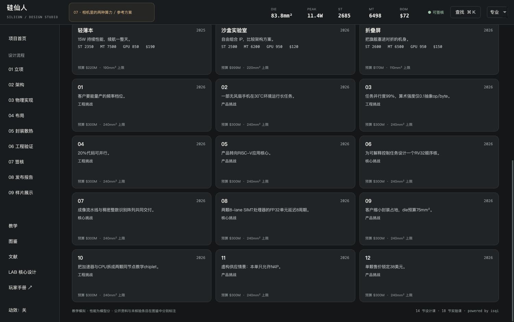
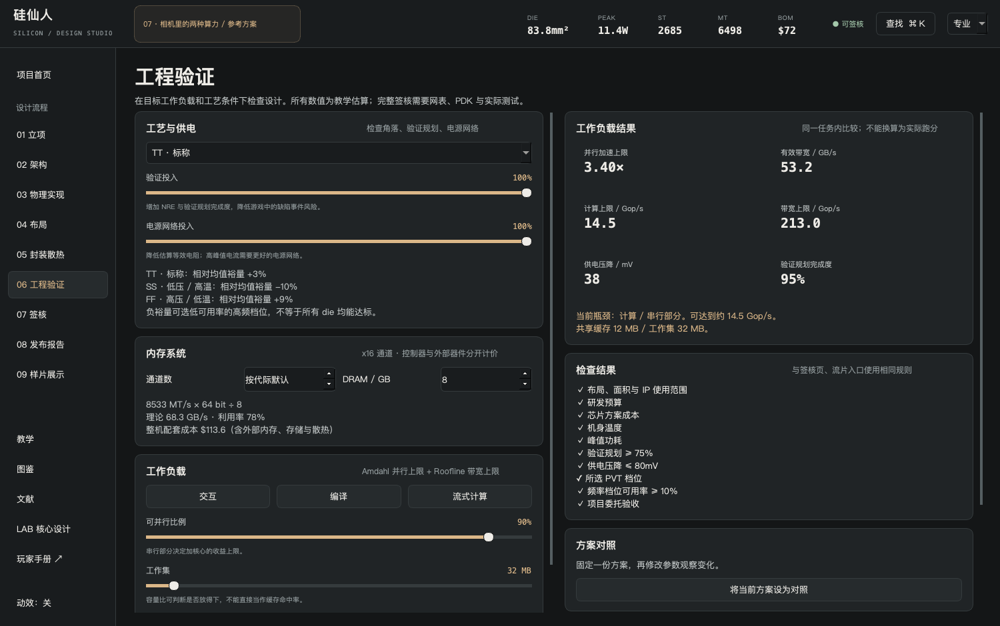

# 12项设计委托

这些关卡是虚构设计项目，门槛和PPA是游戏规则，不冒称真实芯片复刻。每关的初始方案需要调整；参考方案均通过当前引擎的委托验收和教学签核。

## 通关方法

1. 首页选择编号01—12的委托，在简报读目标和初始当前值。
2. 按提示改变设计，到工程页读瓶颈，再回简报核对目标。
3. 签核同时通过所有常规检查与委托验收，然后流片记录完成。市场评分不决定挑战是否完成。
4. 需要对照时先导出自己的.sil，再点击简报“载入参考方案”；该按钮会替换当前方案。

## 关卡一览

| 委托 | 类别 | 关键取舍 |
| --- | --- | --- |
| 01 · 不赌频率档位 | 工程挑战 | 选择SS角落；频率档位可用率≥80%；峰值≤12W |
| 02 · 把热预算还给机身 | 产品挑战 | 持续/峰值多核≥70%；单核模型分≥1000；环境温度固定30°C |
| 03 · 内存墙前的编译农场 | 工程挑战 | 工作负载可达吞吐≥8模型Gop/s；强度保持0.1；并行比例保持99% |
| 04 · 串行代码的逆袭 | 工程挑战 | 应用核总数≤4；可达吞吐≥3模型Gop/s；并行比例保持20% |
| 05 · 开放指令集的迁移账单 | 产品挑战 | 全部应用CPU采用RISC-V；生态适配投入≥70%；至少2颗应用核 |
| 06 · 自己的顺序核心 | 核心挑战 | 至少1颗定制CPU实例；使用定制RV32顺序核心；验证规划≥90% |
| 07 · 相机里的两种算力 | 核心挑战 | 绑定定制ISP；绑定定制NPU；NPU稠密整数峰值≥0.128TOPS；ISP包含双线性去马赛克 |
| 08 · 用驻留隐藏等待 | 核心挑战 | 绑定定制GPU；固定2处理器/8-lane/8周期延迟；128元素AXPY计算≤40周期 |
| 09 · 给封装留一毫米 | 产品挑战 | Die面积≤75mm²；单核模型分≥1400；GPU模型分≥500 |
| 10 · 两颗Die的一张账单 | 工程挑战 | 启用Chiplet；使用2.5D封装；持续/峰值多核≥80% |
| 11 · 先进节点没有产能 | 产品挑战 | 只使用N4P；Die面积≤140mm²；单核模型分≥1400 |
| 12 · 售价不替你省成本 | 产品挑战 | 芯片毛利率≥35%；售价保持38美元；单核模型分≥550；不启用跑分特化 |

## 01 · 不赌频率档位

客户要能量产的频率档位。研发样机很快，但慢角落余量和可出售比例不足；在SS情景下保住档位，同时降低峰值负担。

### 操作路线

1. 工程验证切换SS，查看相对频率余量。
2. 降低大核目标时钟；观察bin可用率和成本变化。
3. 提高PDN投入，按签核与关卡检查同时验收。

### 参考方案验收

| 检查 | 参考方案当前值 |
| --- | --- |
| 选择SS角落 | ss，通过 |
| 频率档位可用率≥80% | 1.000，通过 |
| 峰值≤12W | 10.375，通过 |

[下载参考.sil](../examples/challenges/challenge_bin.sil)。该文件内嵌全部核心，首页可直接导入。参考方案是一种可行解，不是唯一最优解。

### 参考资料的实际支持范围

- [A Case for Thermal-Aware Floorplanning at the Microarchitectural Level](https://jilp.org/vol7/v7paper15.pdf)，Karthik Sankaranarayanan; Sivakumar Velusamy; Mircea R. Stan; Kevin Skadron，2005。正文已核对。定位：p.1 Abstract；§2 Thermal Modeling；§3 Thermal-aware Floorplanning。刊物目录与 PDF 卷号存在差异，保留说明。
  支持：在论文的工作负载与热模型中，布局通过横向热扩散影响热点和性能；结果依赖具体温度/互连模型。 不支持：不支持本作 24°C 功率密度系数或任意手机温度预测；不能从布局颜色推导热可靠性。 本作使用：布局热权衡的定性教材；功率密度模糊图不是论文热模型。

## 02 · 把热预算还给机身

一部无风扇手机在30°C环境运行长任务。初始设计能跑峰值，却无法保持速度；目标是保住单核能力和持续比例，不能换上笔记本风扇。

### 操作路线

1. 固定环境温度30°C，观察持续多核/峰值比例。
2. 减少大核或GPU规模，降低时钟而非只堆散热。
3. 在手机可用散热器中比较，检查机身温度与签核。

### 参考方案验收

| 检查 | 参考方案当前值 |
| --- | --- |
| 持续/峰值多核≥70% | 0.814，通过 |
| 单核模型分≥1000 | 1011.530，通过 |
| 环境温度固定30°C | 30.000，通过 |

[下载参考.sil](../examples/challenges/challenge_thermal.sil)。该文件内嵌全部核心，首页可直接导入。参考方案是一种可行解，不是唯一最优解。

### 参考资料的实际支持范围

- [A Case for Thermal-Aware Floorplanning at the Microarchitectural Level](https://jilp.org/vol7/v7paper15.pdf)，Karthik Sankaranarayanan; Sivakumar Velusamy; Mircea R. Stan; Kevin Skadron，2005。正文已核对。定位：p.1 Abstract；§2 Thermal Modeling；§3 Thermal-aware Floorplanning。刊物目录与 PDF 卷号存在差异，保留说明。
  支持：在论文的工作负载与热模型中，布局通过横向热扩散影响热点和性能；结果依赖具体温度/互连模型。 不支持：不支持本作 24°C 功率密度系数或任意手机温度预测；不能从布局颜色推导热可靠性。 本作使用：布局热权衡的定性教材；功率密度模糊图不是论文热模型。

## 03 · 内存墙前的编译农场

任务并行度99%，算术强度仅0.1抽象op/byte。CPU在等待数据：先改善内存通道，别把更大的核数误当成有效吞吐。

### 操作路线

1. 保持并行度99%与强度0.1，检查Roofline内存上限。
2. 增加x16通道，观察有效GB/s与可达吞吐。
3. 比较通道成本和PHY面积，达到吞吐后停止堆核。

### 参考方案验收

| 检查 | 参考方案当前值 |
| --- | --- |
| 工作负载可达吞吐≥8模型Gop/s | 10.649，通过 |
| 强度保持0.1 | 0.100，通过 |
| 并行比例保持99% | 0.990，通过 |

[下载参考.sil](../examples/challenges/challenge_bandwidth.sil)。该文件内嵌全部核心，首页可直接导入。参考方案是一种可行解，不是唯一最优解。

### 参考资料的实际支持范围

- [Roofline: An Insightful Visual Performance Model for Floating-Point Programs and Multicore Architectures](https://www2.eecs.berkeley.edu/Pubs/TechRpts/2008/EECS-2008-134.pdf)，Samuel Williams; Andrew Waterman; David A. Patterson，2008。正文已核对。定位：报告正文 §3 The Roofline Model（PDF p.3–4），Figure 1；Appendix A 关于带宽/强度测量。
  支持：可达到的性能受峰值算力与内存带宽×运算强度二者约束；强度用到达片外 DRAM 的流量作分母。 不支持：纸面理论带宽不等于实测有效带宽；本作抽象 Gop/s 不是 FLOP/s，也不等于真实程序性能。 本作使用：工作负载页 min(compute, bandwidth×intensity)；所有算力/利用率输入明确为假设。
- [Validity of the single processor approach to achieving large scale computing capabilities](https://doi.org/10.1145/1465482.1465560)，Gene M. Amdahl，1967。书目/摘要核对，未读全文。定位：Crossref 题名、作者、会议与起页；未取得原文。
  支持：书目身份可确认。课程中的 S=1/((1-p)+p/N) 另按固定工作量与理想并行假设推导。 不支持：不称公式已经逐字与原文核对；不将固定串行比例当作所有程序的常数。 本作使用：工程页和课程使用自足推导的理想加速上限；异构核折算额外是游戏假设。

## 04 · 串行代码的逆袭

20%代码可并行。十二核版本增加面积，交互响应仍由串行路径决定；交付不超过四颗应用核的方案。

### 操作路线

1. 保持并行比例20%，看Amdahl上限。
2. 用较少快核替代大量中小核，比较单核与成本。
3. 保持可达吞吐≥3，核数≤4并完成签核。

### 参考方案验收

| 检查 | 参考方案当前值 |
| --- | --- |
| 应用核总数≤4 | 2.000，通过 |
| 可达吞吐≥3模型Gop/s | 4.479，通过 |
| 并行比例保持20% | 0.200，通过 |

[下载参考.sil](../examples/challenges/challenge_serial.sil)。该文件内嵌全部核心，首页可直接导入。参考方案是一种可行解，不是唯一最优解。

### 参考资料的实际支持范围

- [Validity of the single processor approach to achieving large scale computing capabilities](https://doi.org/10.1145/1465482.1465560)，Gene M. Amdahl，1967。书目/摘要核对，未读全文。定位：Crossref 题名、作者、会议与起页；未取得原文。
  支持：书目身份可确认。课程中的 S=1/((1-p)+p/N) 另按固定工作量与理想并行假设推导。 不支持：不称公式已经逐字与原文核对；不将固定串行比例当作所有程序的常数。 本作使用：工程页和课程使用自足推导的理想加速上限；异构核折算额外是游戏假设。

## 05 · 开放指令集的迁移账单

产品转向RISC-V应用核心。硬件换核只是第一步，软件适配也要预算；禁止混入Arm应用核掩盖迁移问题。

### 操作路线

1. 清空应用CPU组，选择RISC-V模板。
2. 给应用和驱动适配明确投入，观察NRE。
3. 检查应用核ISA统一，比较持续吞吐与封装成本。

### 参考方案验收

| 检查 | 参考方案当前值 |
| --- | --- |
| 全部应用CPU采用RISC-V | True，通过 |
| 生态适配投入≥70% | 0.800，通过 |
| 至少2颗应用核 | 4.000，通过 |

[下载参考.sil](../examples/challenges/challenge_open.sil)。该文件内嵌全部核心，首页可直接导入。参考方案是一种可行解，不是唯一最优解。

### 参考资料的实际支持范围

- [The RISC-V Instruction Set Manual, Volume I — RV32I Base Integer Instruction Set](https://docs.riscv.org/reference/isa/v20260120/unpriv/rv32.html)，RISC-V International，2026。正文已核对。定位：Integer Register State、Integer Computational Instructions、Control Transfer、Load and Store、Memory Ordering 与 Environment Call/Breakpoints；使用官方章节标题定位。
  支持：x0 恒为零；32 位整数运算、12 位符号扩展立即数、分支/跳转、大小端与访存语义，FENCE 与环境调用。 不支持：本 lab 不实现特权态、执行环境、二进制取指、外设或全部非对齐访存行为，不能宣称完整 RISC-V 合规。 本作使用：isa.py 执行语义与 32 位编码的直接规范。HALT 为实验伪指令，不是标准指令。
- [SiFive Performance P600 Series — P650/P670](https://www.sifive.com/cores/performance-p650-670)，SiFive，2026。正文已核对。定位：P650/P670；P670 的 thirteen-stage, four-issue, out-of-order pipeline 与 vector application processor 描述。
  支持：厂商将 P670 描述为 13 级、四发射、乱序、向量应用处理器；P650 面向不需要向量计算的情况。 不支持：不支持游戏 2.76mm²、2.4GHz、1.2W、授权费或 Android 生态分；不把营销 SPEC/GHz 与本作模型等价。 本作使用：区分实际核心产品与基础 ISA；定制核 lab 不模拟 P670 本身。

## 06 · 自己的顺序核心

为可解释控制任务设计一个RV32顺序核。必须发布你的硬件定义并在SoC里实际使用；模板核无法满足这项交付。

### 操作路线

1. LAB新建CPU，选择RV32与顺序发射，命名。
2. 运行固定验证，发布到IP库。
3. 替换原应用集群加入SoC，完成PDN/验证投入并导出.sil。

### 参考方案验收

| 检查 | 参考方案当前值 |
| --- | --- |
| 至少1颗定制CPU实例 | 1.000，通过 |
| 使用定制RV32顺序核心 | True，通过 |
| 验证规划≥90% | 0.950，通过 |

[下载参考.sil](../examples/challenges/challenge_lab_cpu.sil)。该文件内嵌全部核心，首页可直接导入。参考方案是一种可行解，不是唯一最优解。

### 参考资料的实际支持范围

- [The RISC-V Instruction Set Manual, Volume I — RV32I Base Integer Instruction Set](https://docs.riscv.org/reference/isa/v20260120/unpriv/rv32.html)，RISC-V International，2026。正文已核对。定位：Integer Register State、Integer Computational Instructions、Control Transfer、Load and Store、Memory Ordering 与 Environment Call/Breakpoints；使用官方章节标题定位。
  支持：x0 恒为零；32 位整数运算、12 位符号扩展立即数、分支/跳转、大小端与访存语义，FENCE 与环境调用。 不支持：本 lab 不实现特权态、执行环境、二进制取指、外设或全部非对齐访存行为，不能宣称完整 RISC-V 合规。 本作使用：isa.py 执行语义与 32 位编码的直接规范。HALT 为实验伪指令，不是标准指令。
- [RISC-V Unprivileged ISA — M Extension for Integer Multiplication and Division](https://docs.riscv.org/reference/isa/v20260120/unpriv/m-st-ext.html)，RISC-V International，2026。正文已核对。定位：Multiplication；Division；Table 1: Semantics for division by zero and division overflow。
  支持：低/高乘积的符号组合；除法向零截断；除零商全 1、余数为被除数；INT_MIN/-1 的规定结果。 不支持：M 规范不指定乘除单元延迟、面积或功耗，不能由扩展开关凭空得出能效提升。 本作使用：M 指令语义与已实现指令表；延迟由 lab 输入给定。

## 07 · 相机里的两种算力

成像流水线与稠密整数识别阵列共同交付。ISP负责RAW处理，NPU负责MAC，不能用AI综合分代替硬件定义。

### 操作路线

1. LAB设计启用双线性去马赛克的ISP，运行常量帧和渐变。
2. 设计8×8或更大INT8 NPU，给足scratchpad，验证GEMM。
3. 发布两类IP并绑定SoC，检查导出.sil包含二者。

### 参考方案验收

| 检查 | 参考方案当前值 |
| --- | --- |
| 绑定定制ISP | True，通过 |
| 绑定定制NPU | True，通过 |
| NPU稠密整数峰值≥0.128TOPS | 0.128，通过 |
| ISP包含双线性去马赛克 | True，通过 |

[下载参考.sil](../examples/challenges/challenge_camera.sil)。该文件内嵌全部核心，首页可直接导入。参考方案是一种可行解，不是唯一最优解。

### 参考资料的实际支持范围

- [Malvar-He-Cutler Linear Image Demosaicking](https://doi.org/10.5201/ipol.2011.g_mhcd)，Pascal Getreuer，2011。正文已核对。定位：§1 Introduction / Figure 2 Bayer pattern; §2 Algorithm, initial bilinear green axial-neighbor and red/blue diagonal-neighbor formulas.
  支持：Bayer采样与demosaic问题；文章先介绍bilinear baseline再讨论Malvar-He-Cutler的5×5跨通道校正。 不支持：本作只实现基础bilinear，未实现论文MHC 5×5改进；边缘缩小邻域与gamma/black-level是本作规则，未由论文验证；不是完整相机ISP。 本作使用：ISP lab讲解bilinear插值、black-level、幂gamma与输出量化；原文MHC仅为延伸阅读。
- [In-Datacenter Performance Analysis of a Tensor Processing Unit](https://arxiv.org/abs/1704.04760)，Norman P. Jouppi, Cliff Young, Nishant Patil, David Patterson, Gaurav Agrawal, Raminder Bajwa, Sarah Bates, Suresh Bhatia, Nan Boden, Al Borchers, Rick Boyle, Pierre-luc Cantin, Clifford Chao, Chris Clark, Jeremy Coriell, Mike Daley, Matt Dau, Jeffrey Dean, Ben Gelb, Tara Vazir Ghaemmaghami, Rajendra Gottipati, William Gulland, Robert Hagmann, C. Richard Ho, Doug Hogberg, John Hu, Robert Hundt, Dan Hurt, Julian Ibarz, Aaron Jaffey, Alek Jaworski, Alexander Kaplan, Harshit Khaitan, Daniel Killebrew, Andy Koch, Naveen Kumar, Steve Lacy, James Laudon, James Law, Diemthu Le, Chris Leary, Zhuyuan Liu, Kyle Lucke, Alan Lundin, Gordon MacKean, Adriana Maggiore, Maire Mahony, Kieran Miller, Rahul Nagarajan, Ravi Narayanaswami, Ray Ni, Kathy Nix, Thomas Norrie, Mark Omernick, Narayana Penukonda, Andy Phelps, Jonathan Ross, Matt Ross, Amir Salek, Emad Samadiani, Chris Severn, Gregory Sizikov, Matthew Snelham, Jed Souter, Dan Steinberg, Andy Swing, Mercedes Tan, Gregory Thorson, Bo Tian, Horia Toma, Erick Tuttle, Vijay Vasudevan, Richard Walter, Walter Wang, Eric Wilcox, and Doe Hyun Yoon，2017。正文已核对。定位：Abstract; §2 TPU Architecture / Figure 1–2: 256×256 MAC array, Accumulators, Unified Buffer; §4 roofline analysis.
  支持：特定TPUv1的稠密矩阵阵列、本地缓冲、数据搬运与算力/带宽限制；原文INT16输入有吞吐降低，非统一同速实现。 不支持：本作不实现TPU ISA、92TOPS/28MiB或论文硬件精度时序；假设每PE每周期一个INT8/INT16 MAC，INT16需要独立更宽乘法器PPA估算；无稀疏/量化标定。 本作使用：NPU lab为整数GEMM与tile/scratchpad实验，不将论文实际TPU指标映射任意设计。

## 08 · 用驻留隐藏等待

两颗8-lane SIMT处理器的FP32单元延迟8周期。你不能增加处理器或缩短ALU延迟，要通过驻留与交错发射缩短128元素AXPY计算。

### 操作路线

1. LAB GPU固定2处理器、8-lane、ALU延迟8。
2. 比较驻留1/4个warp的计算周期与传输周期。
3. 保持资源限制，发布并用于SoC；固定任务计算≤40周期。

### 参考方案验收

| 检查 | 参考方案当前值 |
| --- | --- |
| 绑定定制GPU | True，通过 |
| 固定2处理器/8-lane/8周期延迟 | True，通过 |
| 128元素AXPY计算≤40周期 | 35.000，通过 |

[下载参考.sil](../examples/challenges/challenge_simt.sil)。该文件内嵌全部核心，首页可直接导入。参考方案是一种可行解，不是唯一最优解。

### 参考资料的实际支持范围

- [CUDA Programming Guide — 2.3 Writing SIMT Kernels](https://docs.nvidia.com/cuda/cuda-programming-guide/02-basics/writing-cuda-kernels.html)，NVIDIA，2026。正文已核对。定位：Basics of SIMT; Global Memory / coalescing; shared-memory bank conflicts. Source page describes divergent code paths and 32-thread NVIDIA warps.
  支持：SIMT每线程状态/控制流、warp内分歧、访存事务合并和bank冲突影响吞吐。 不支持：本作可调warp4–64是研究假设，不是CUDA支持的warp宽度；未运行CUDA、PTX或真实光栅pipeline，不声称模拟NVIDIA GPU。 本作使用：GPU lab计算FP32逐lane任务，并对分歧路径假设串行；两指令AXPY非FMA，传输与计算不重叠。

## 09 · 给封装留一毫米

客户缩小封装占地，die预算75mm²。用有限核数、缓存和GPU规模保住基本能力；空白布局和昂贵频率档位都要付钱。

### 操作路线

1. 查看逻辑块和SRAM面积，减少不必要缓存与核数。
2. 重新自动布局，检查封装尺寸和拥塞。
3. 满足面积和能力门槛后检查单颗成本。

### 参考方案验收

| 检查 | 参考方案当前值 |
| --- | --- |
| Die面积≤75mm² | 56.478，通过 |
| 单核模型分≥1400 | 1444.959，通过 |
| GPU模型分≥500 | 700.000，通过 |

[下载参考.sil](../examples/challenges/challenge_compact.sil)。该文件内嵌全部核心，首页可直接导入。参考方案是一种可行解，不是唯一最优解。

### 参考资料的实际支持范围

- [CACTI 7: New Tools for Interconnect Exploration in Innovative Off-Chip Memories](https://doi.org/10.1145/3085572)，Rajeev Balasubramonian; Andrew B. Kahng; Naveen Muralimanohar; Ali Shafiee; Vaishnav Srinivas，2017。正文已核对。定位：作者公开稿 p.1 Abstract；§1 Introduction；CACTI README 的 process-specific values。
  支持：建模片外内存 I/O 的功率、时序、互连与拓扑；论文在明确系统配置下验证工具，并给出两种内存通道案例。 不支持：不是本作 LPDDR5X 控制器仿真，也没有用它计算 3/2nm SRAM 面积；论文中的 18%、22% 和成本收益不能迁移到本作或手机。 本作使用：缓存 lab 为标签/LRU 模拟，PPA 未调用 CACTI；本条只解释可提取延迟/能耗的真实工具需要哪些输入。

## 10 · 两颗Die的一张账单

把加速器与CPU拆成两颗同节点教学chiplet。交付2.5D封装，分别计裸die成本；不能把逻辑总图当实际多die布线。

### 操作路线

1. 封装页选择本作2.5D方案，再开启Chiplet。
2. 检查两颗裸die成本与额外组装费用。
3. 持续比例≥80%，保住供电裕量；展示页读清逻辑总图标记。

### 参考方案验收

| 检查 | 参考方案当前值 |
| --- | --- |
| 启用Chiplet | True，通过 |
| 使用2.5D封装 | imc25d，通过 |
| 持续/峰值多核≥80% | 0.907，通过 |

[下载参考.sil](../examples/challenges/challenge_chiplet.sil)。该文件内嵌全部核心，首页可直接导入。参考方案是一种可行解，不是唯一最优解。

### 参考资料的实际支持范围

- [The future of microprocessors](https://doi.org/10.1145/1941487.1941507)，Shekhar Borkar; Andrew A. Chien，2011。书目/摘要核对，未读全文。定位：Crossref 书目与摘要；未取得全文。
  支持：已核验摘要把能效描述为性能的根本约束。 不支持：不能证明本作具体电压、漏电温度系数或缺陷率。 本作使用：背景阅读，无数值映射。

本关chiplet面积拆分、两die、2.5D要求及互连损失都是明确游戏规则。上列Borkar/Chien仅为能效背景，不作为chiplet公式或实际封装认证依据。

## 11 · 先进节点没有产能

虚构供应情景：本单只允许N4P。相同产品目标要在较大面积和更高功耗下重做；不能用未来节点绕过约束。

### 操作路线

1. 切回N4P，重新检查面积和参考频率缩放。
2. 降低核规模或缓存，避免超过功耗与面积预算。
3. 保证基本单核能力，完成档位/成本签核。

### 参考方案验收

| 检查 | 参考方案当前值 |
| --- | --- |
| 只使用N4P | n4p，通过 |
| Die面积≤140mm² | 78.453，通过 |
| 单核模型分≥1400 | 1450.707，通过 |

[下载参考.sil](../examples/challenges/challenge_supply.sil)。该文件内嵌全部核心，首页可直接导入。参考方案是一种可行解，不是唯一最优解。

### 参考资料的实际支持范围

- [CACTI 7: New Tools for Interconnect Exploration in Innovative Off-Chip Memories](https://doi.org/10.1145/3085572)，Rajeev Balasubramonian; Andrew B. Kahng; Naveen Muralimanohar; Ali Shafiee; Vaishnav Srinivas，2017。正文已核对。定位：作者公开稿 p.1 Abstract；§1 Introduction；CACTI README 的 process-specific values。
  支持：建模片外内存 I/O 的功率、时序、互连与拓扑；论文在明确系统配置下验证工具，并给出两种内存通道案例。 不支持：不是本作 LPDDR5X 控制器仿真，也没有用它计算 3/2nm SRAM 面积；论文中的 18%、22% 和成本收益不能迁移到本作或手机。 本作使用：缓存 lab 为标签/LRU 模拟，PPA 未调用 CACTI；本条只解释可提取延迟/能耗的真实工具需要哪些输入。
- [A Case for Thermal-Aware Floorplanning at the Microarchitectural Level](https://jilp.org/vol7/v7paper15.pdf)，Karthik Sankaranarayanan; Sivakumar Velusamy; Mircea R. Stan; Kevin Skadron，2005。正文已核对。定位：p.1 Abstract；§2 Thermal Modeling；§3 Thermal-aware Floorplanning。刊物目录与 PDF 卷号存在差异，保留说明。
  支持：在论文的工作负载与热模型中，布局通过横向热扩散影响热点和性能；结果依赖具体温度/互连模型。 不支持：不支持本作 24°C 功率密度系数或任意手机温度预测；不能从布局颜色推导热可靠性。 本作使用：布局热权衡的定性教材；功率密度模糊图不是论文热模型。

## 12 · 售价不替你省成本

单颗售价锁定38美元。毛利至少35%，功耗不能靠跑分作弊掩盖；在成熟节点上做一颗能量产的低成本芯片。

### 操作路线

1. 保持售价38，读取裸die/封装/测试的分项成本。
2. 限制缓存、GPU与高频档位，比较成本与基础性能。
3. 取消跑分特化，检查35%毛利和单核能力。

### 参考方案验收

| 检查 | 参考方案当前值 |
| --- | --- |
| 芯片毛利率≥35% | 0.395，通过 |
| 售价保持38美元 | 38.000，通过 |
| 单核模型分≥550 | 774.671，通过 |
| 不启用跑分特化 | True，通过 |

[下载参考.sil](../examples/challenges/challenge_margin.sil)。该文件内嵌全部核心，首页可直接导入。参考方案是一种可行解，不是唯一最优解。

### 参考资料的实际支持范围

- [Cost-size optima of monolithic integrated circuits](https://doi.org/10.1109/PROC.1964.3442)，B. T. Murphy，1964。书目/摘要核对，未读全文。定位：Crossref DOI 10.1109/PROC.1964.3442；题名、作者、卷期与页码。未取得论文正文。
  支持：确认这篇论文的身份和良率/尺寸成本研究主题。 不支持：没有核验具体 Murphy 公式、D0、成熟度、晶圆价格或现代节点良率，不能称本作已经按原文校准。 本作使用：economics.py 的 Murphy 型公式为游戏选用的解析假设，不标为已验证原文实现。

Murphy目前只完成书目核验，本作具体良率函数未由论文正文确认。该关成本/售价门槛仍是游戏假设。

完成后可导出.sil与模拟PNG，在分享说明里注明项目、核心和模型版本。继续阅读[文件与分享](sharing.md)。
