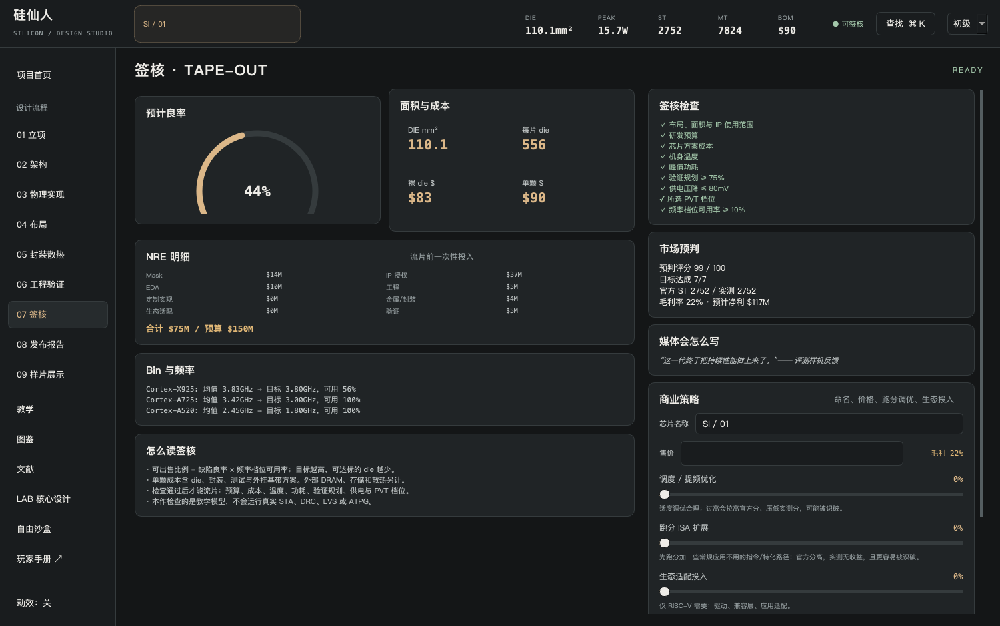

# 常见问题与故障排查

先区分启动问题、文件问题和设计检查。不要为了让提示消失随意删除文件或修改核心摘要。

## 游戏无法启动

| 现象 | 检查和处理 |
| --- | --- |
| 找不到exe/app | 当前仅源码发行，安装Python3.12后运行对应脚本 |
| Windows提示找不到py/python | 安装Python3.12，勾选Launcher和PATH；验证py -3.12 --version |
| Mac脚本没有执行权限 | 终端bash run.command，或chmod +x run.command后./run.command |
| Python版本太低 | 使用Python3.12创建项目环境，删除环境前确认不是玩家saves目录 |
| 首次依赖安装失败 | 检查PyPI网络，保留pip错误；脚本不能绕过无效依赖 |
| Mac旧系统缺少Qt wheel | 当前PySide6要求macOS14+，不承诺macOS13及以前 |
| 更新后打不开 | 不复用跨系统.venv，保留saves，重新用当前脚本创建环境 |
| 窗口过挤 | 保持1180×760，检查显示缩放；独立滚动参数和结构 |

Windows也可在命令行运行.venv\Scripts\python.exe -m silicon_professor，Mac运行.venv/bin/python -m silicon_professor查看错误。反馈时不要公开账号、密码或无关环境日志。

## 核心设计无法验证或发布

**命中延迟不能大于未命中延迟：** 这是当前缓存模型的输入约束，修正相应硬件值。

**MUL/DIV或Zbb指令不支持：** 检查选的ISA和扩展。RV32需要启用对应扩展；IA-32/AArch64使用各自原生子集，不能沿用RV32汇编。

**NPU scratchpad不够：** 检查阵列/精度/累加位宽；硬件至少容纳完整阵列K=1。更大的测试K也可能超容量，本作暂不自动做K方向切块。

**固定验证按钮通过，但发布失败：** 检查名称是否为空，资产库是否达到64项、硬件是否刚被修改。修改后需要重新验证。

**已发布核心改参数后导出按钮灰了：** 新硬件是未发布草稿，原资产仍在IP库。重新验证/发布生成新ID，再导出新版本。

**测试台输出突然消失：** 修改输入后清除旧输出是预期行为，避免误读结果；固定硬件验证状态不因此改变。

## SoC无法流片

| 阻塞项 | 优先处理 |
| --- | --- |
| 布局/面积/IP | 清除重叠、选合法制程/IP、确认至少一组CPU；不要混用不支持的应用ISA |
| NRE超预算 | 减少定制、许可/实现投入；别只提高售价 |
| 单颗成本太高 | 缩小die、减少SRAM和封装成本，降低激进频率档位 |
| 机身温度/峰值功耗 | 降低时钟或规模；手机不要用服务器散热器绕过约束 |
| 验证规划不足 | 在工程页提高验证投入；规划不是实测覆盖率 |
| 压降超过80mV | 提高PDN投入，降低峰值电流或选择更低电阻的允许封装 |
| PVT/bin失败 | 降低目标时钟，重新检查可出售比例 |
| 项目委托未完成 | 返回简报，看每个目标的当前值；完整签核本身不代替关卡目标 |

## 结果看起来不合理

**为什么改了核心，短测试IPC完全一样？** 默认5条指令访存程序被冷cache主导，2宽与12宽可能都是53周期。使用“运行CPU性能套件”，逐项观察独立运算、依赖链、缓存重用、乘法任务，设为对照再改硬件；不会为了看起来有效而人为改IPC。

**为什么更宽的CPU没有快四倍？** 依赖链、端口、cache、分派/提交宽度、队列与串行部分都会限制收益。

**为什么GPU加驻留warp没有降低传输周期？** 它隐藏本模型的ALU等待，传输数据量和带宽没有变化。当前模型还假设计算与传输不重叠。

**为什么CPU IPC不能跨架构排名？** 指令数量、指令语义和测试任务不同；SoC IPC指数还有教学映射，不能与真实CPU IPC等同。

**为什么NPU峰值和AI综合分不一样？** 峰值是注明精度的阵列理想TOPS，综合分还包含其他游戏因素，单位不同。

**为什么换版本旧设计变分了？** `.sil`保存核心定义，但公式、目标工艺/封装/市场等运行模型仍可能更新。文件内有来源版本，便于排查。

## 导入失败

| 错误 | 含义 |
| --- | --- |
| 内容不是SoC/IP格式 | 扩展名正确不代表JSON内容正确；检查下载是否完整 |
| 缺少内嵌CPU/IP/模板 | 文件丢失依赖；向发送者索要完整.sil重新导出 |
| 摘要不匹配 | 硬件、名称、模型或参考制程被修改或损坏；保留原文件核对 |
| 无法解释硬件字段/模型schema | 当前版本无法表达这些语义；更新到能理解该内容的版本 |
| 字段范围、NaN或类型错误 | 计数必须整数、布尔必须true/false；不接受NaN/Infinity |
| 版本不同提示 | 是诊断提示，不单独阻止读取 |

## 反馈问题

到[GitHub Issues](https://github.com/qi-1021/silicon-immortal/issues)记录：游戏版本、系统/架构、操作步骤、预期/实际结果、错误文字。涉及设计时附一个最小`.sil/.cor`与截图；先检查附件是否包含你不想公开的名称或内容。当前游戏不含在线上传按钮，不会自动提交玩家文件。

## 联系作者

也可以写邮件至[qiisme1021@gmail.com](mailto:qiisme1021@gmail.com)，或提交PR。作者看到后会回应；操作不顺、模型遗漏与来源错误都欢迎明确指出。描述可复现，或给出论文标题、链接与章节，能帮助优先核对和改进。
