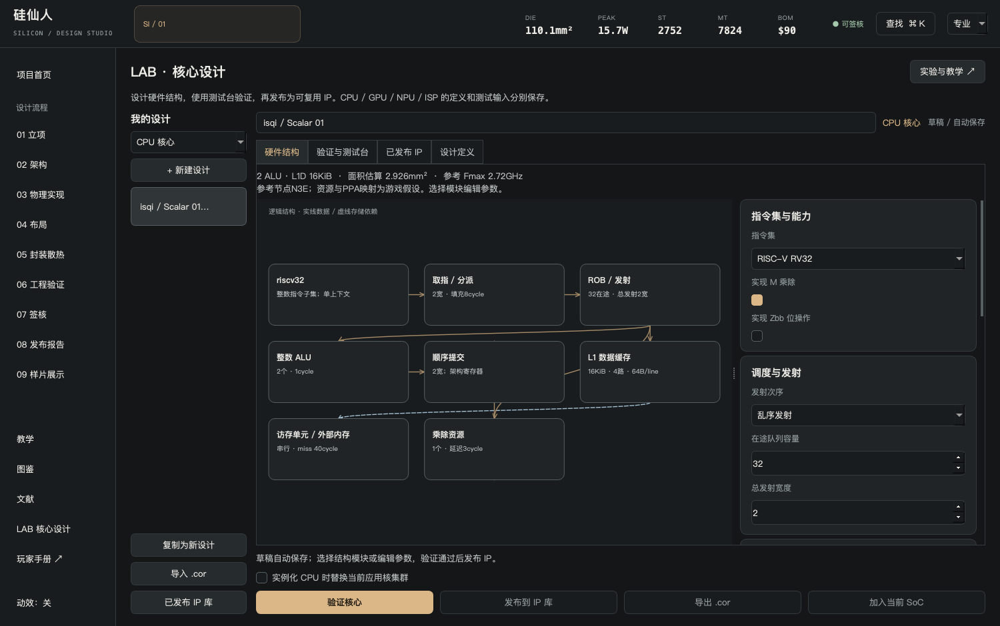
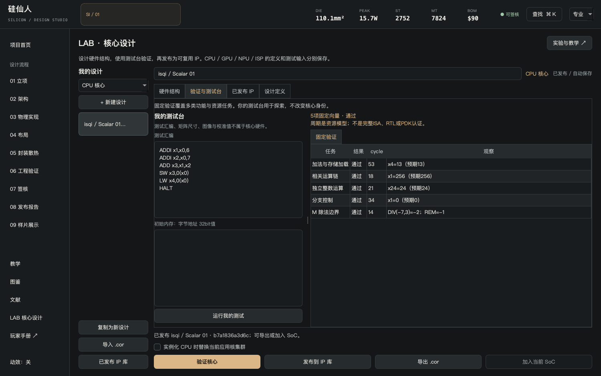
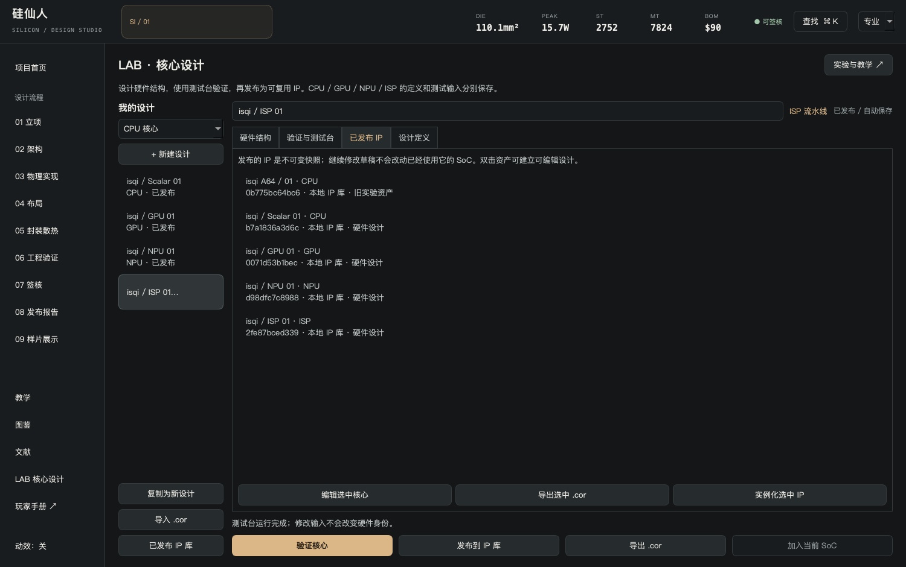

# 第一颗核心：设计、验证、发布

这一章设计一个可保存、可分享、可用于SoC的RV32核心。你不用先写完整软件或读完所有课程。

## 1. 建立硬件草稿

首页点击“设计自己的核心 · LAB”，或侧栏“LAB核心设计”。左侧选择“CPU核心”，点击“新建设计”，将名称改为`我的RV32 / 01`。



| 区域 | 用途 |
| --- | --- |
| 左侧我的设计 | 切换草稿、复制、新建、导入.cor |
| 顶部名称 | 给核心命名；名称参与发布资产身份 |
| 中央硬件结构 | 按当前资源生成逻辑模块图，点击模块定位参数 |
| 右侧参数 | 指令集、调度、运算和缓存资源；可展开专家参数 |
| 验证与测试台 | 运行固定验证和自己的测试，查看输出/时序 |
| 已发布IP | 管理发布资产，载入SoC内嵌核心或导出 |
| 设计定义 | 查看可复查的JSON硬件和独立测试台 |

草稿自动保存。使用“复制为新设计”保留对照方案，名字最多64字符。发布资产保持不可变，复制或继续改草稿不会偷偷改动已经使用它的SoC。

## 2. 决定核心的能力

保持RISC-V RV32，先保留M乘除扩展。选择结构图的“ROB/发射”或“顺序发射队列”，将发射次序设为顺序发射。默认2宽、2个ALU、16KiB数据缓存即可开始。

| 参数 | 你在决定什么 | 观察位置 |
| --- | --- | --- |
| RV32 / IA-32 / AArch64 | 当前功能执行器的整数子集 | 指令合法性、寄存器位宽、编码 |
| M/Zbb | RV32是否实现可选乘除/位操作 | 固定验证、对应程序是否可执行 |
| 顺序/乱序 | 阻塞指令后能否发射独立后继 | 相关链与独立任务周期 |
| 共同宽度 | 取指/分派/提交的共同上限 | 总发射与提交时序 |
| 队列容量 | 同时在途的指令数量 | ROB/队列满停顿 |
| ALU/乘除资源 | 每周期可发射的对应运算 | 资源争用、面积估算 |
| Cache容量/路数/行长 | 数据缓存的几何与相联方式 | 命中/未命中、访存周期 |

初级模式折叠一些参数。点击相关模块或“展开专家参数”可以查看全部。不要把前端填充周期直接当成真实厂家流水线级数。

## 3. 运行固定验证

点击底部“验证核心”。页面切换到验证区，列出访存、相关运算、独立运算、分支与已启用扩展的检查。



通过的含义是本模型的这些向量通过；它不证明完整RV32合规、RTL正确性或PDK可制造性。验证失败会显示具体约束或任务，先修复再发布。

## 4. 写自己的测试

在“我的测试台”输入：

```text
ADDI x1,x0,6
ADDI x2,x0,7
MUL x3,x1,x2
SW x3,0(x0)
LW x4,0(x0)
HALT
```

点击“运行我的测试”，观察`x3=42`、`x4=42`。HEX显示`0x2a`也是42。切到调度时序，读分派、发射、完成、提交五列；数据依赖会使后继等待。

如果取消M扩展再运行MUL，程序应报不支持指令。硬件修改会使旧固定验证失效；再次验证后才可发布。只改测试汇编不会改变硬件身份，但旧测试输出会清除，避免把两次结果混在一起。

## 5. 发布与导出

验证通过后点击“发布到IP库”。名称、类别和硬件定义生成内容ID。现在可以“导出.cor”，例如`我的RV32.cor`。



`.cor`是UTF-8 JSON，不是二进制机器码或HDL。导入时重新验证硬件和固定向量；文件附带的“通过”或IPC不直接当成可信结果。

## 6. 在SoC中使用

进入“自己的顺序核心”挑战或研究沙盒。在LAB选中已发布核心，勾选“实例化CPU时替换当前应用核集群”，点击“加入当前SoC”。然后在架构页设实例数量、L2和目标频率。

RV32、IA-32和AArch64应用CPU集群不能直接混搭到同一操作系统模型中。现实SoC可以有异构控制核，但本作尚未建模这条软件执行路径。

最后导出`.sil`。这个文件同时携带SoC实例参数和你的核心定义，朋友只收`.sil`也能恢复。详细规则见[文件与分享](sharing.md)。

下一步：[加速器设计](accelerators.md) · [第一颗SoC](soc.md)
