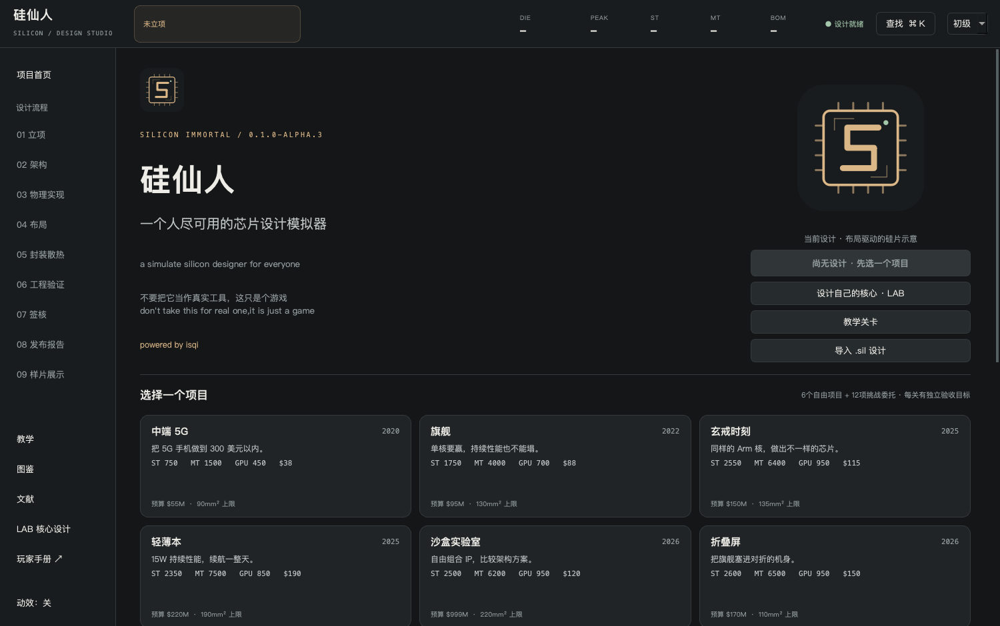

# 安装与启动

推荐从[GitHub Releases](https://github.com/qi-1021/silicon-immortal/releases)下载与你的系统和CPU架构对应的便携包。仓库“Code → Download ZIP”下载的是源码，需要Python；Release附件包含运行环境。

## 选择下载文件

| 系统 | 发行附件名中的标记 | 要求 |
| --- | --- | --- |
| Windows | `Windows-x64.zip` | Windows 10/11，64位Intel/AMD处理器 |
| Mac Apple Silicon | `macOS-arm64.zip` | macOS 14或更新，M系列处理器 |
| Mac Intel | `macOS-x64.zip` | macOS 14或更新，Intel处理器 |

在Mac“关于本机”查看芯片；Windows在“设置 → 系统 → 系统信息”查看系统类型。当前没有Windows ARM发行包。不要在Intel Mac上下载arm64包。

## Windows便携包

1. 下载`Windows-x64.zip`。
2. 右键压缩文件，选择“全部解压缩”。放到自己的可写目录，例如`D:\Games\SiliconImmortal`。不要在压缩文件预览里直接运行。
3. 打开解压后的文件夹，双击`SiliconImmortal\SiliconImmortal.exe`。
4. 第一次选择初级模式，打开LAB或一个项目。
5. 浏览器打开`docs\player-guide\index.html`阅读本手册，不需要网络。

`_internal`目录含Python和Qt运行库。保持它与exe一起，不要只移动exe。便携包不需要管理员权限，也不需要另外安装Python。

发行包尚未购买代码签名证书。系统如果提示未知发布者，先核对下载地址与SHA-256；只对确认来源的这个文件使用系统提供的“更多信息 → 仍要运行”。不要关闭系统的整体安全保护。

## macOS便携包

1. 下载适合处理器的Mac ZIP，双击解压。
2. 打开解压文件夹里的`SiliconImmortal.app`。可以将app拖到“应用程序”。
3. 浏览器打开包内`docs/player-guide/index.html`阅读手册。
4. 初次打开如被Gatekeeper拦截，确认下载来自本仓库并核对摘要后，按系统提示在“系统设置 → 隐私与安全性”对这个app选择“仍要打开”。部分系统也提供Finder右键/按Control点击app→“打开”。

当前Mac包使用构建时的本地签名，没有Apple Developer身份签名和公证；不能承诺首次双击不会弹出安全提示。不要运行关闭Gatekeeper的全局命令。若系统明确报告文件损坏或不支持该架构，先重新解压、重新下载并检查系统版本。

官方PySide6 6.12 macOS wheel要求macOS14。macOS13和更早版本不在当前发行支持范围。

## 第一次进入



| 入口 | 功能 |
| --- | --- |
| 设计自己的核心 · LAB | 直接设计CPU/GPU/NPU/ISP，无需先建SoC |
| 教学关卡 | 按目标学习产品设计决策 |
| 选择项目 | 6个自由产品项目与12项独立挑战 |
| 导入.sil设计 | 打开朋友的完整SoC方案 |
| 顶部初级/中级/高级/专业 | 控制提示和参数展开，不改变硬件 |

游戏运行不要求联网。初次使用建议保留窗口推荐大小；最小窗口为1180×760，系统缩放较大时可能需要更高的显示分辨率。界面中的结构区、参数区和报告区都可分别滚动。

## 源码运行

源码适合修改游戏、复查模型或没有对应便携包的玩家。安装Python3.12，下载或克隆仓库。Windows双击`run.bat`；Mac双击`run.command`，也可以在终端运行`./run.command`。

第一次源码启动会在项目内创建`.venv`，联网安装固定PySide6版本；以后从同一目录运行。依赖安装失败会显示错误，不会伪装成启动成功。

```bash
python -m venv .venv
# Windows
.venv\Scripts\python.exe -m pip install -r requirements.txt
.venv\Scripts\python.exe -m silicon_professor
# macOS
.venv/bin/python -m pip install -r requirements.txt
.venv/bin/python -m silicon_professor
```

首次联网下载依赖耗时取决于网络。源码入口需要Python；Release便携包不需要。不要把安装Python失败和芯片设计失败混为一谈。

继续阅读：[第一颗核心](first-core.md) · [备份与更新](sharing.md)
