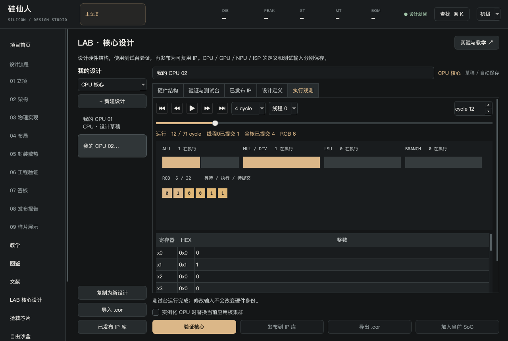
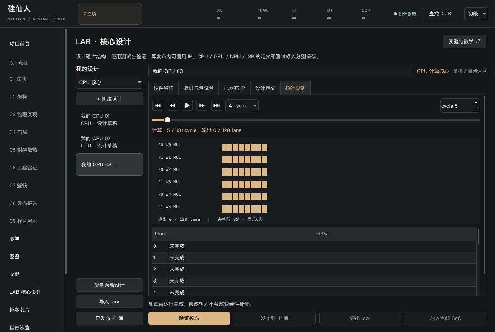
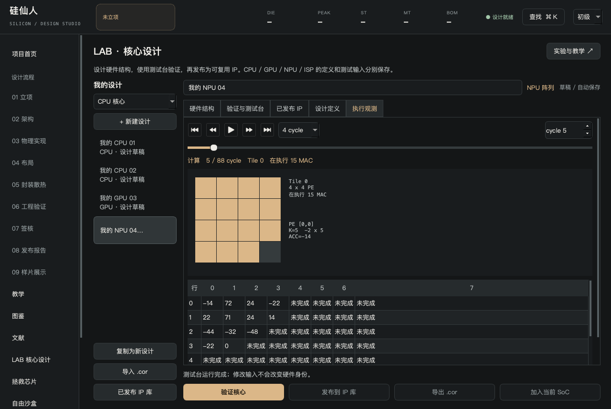
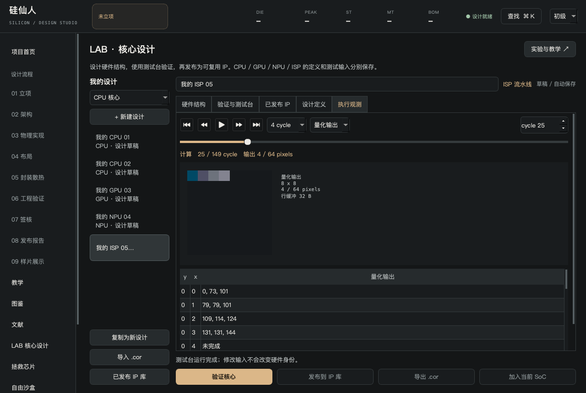

# 执行观测与资源实验

LAB的“验证与测试台”提供资源实验草稿。选预设、运行测试后，会打开独立“执行观测”页。可播放、暂停、逐周期和拖动周期滑块；修改输入或硬件立即停止并清除旧回放。

## CPU：共享不等于翻倍

SMT预设运行两个独立汇编程序。寄存器与教学地址空间分别保存，前端、发射、ALU、乘除资源、退休宽度和缓存共享；两个实际测试线程均分ROB。独跑对照之和除以共享核心周期得到加速比，竞争资源时不保证提升。

CPU观测显示全核资源、ROB占用和所选线程的已提交寄存器。另一线程先提交不会让回放漏掉它的结果；状态只在顺序提交后改变。没有OS、线程通信、缓存一致性或投机访存。

MSHR预设使用独立的缓存行未命中。增加请求槽可以重叠等待，但指针依赖链依然等待前一次load。同缓存行请求可合并，store/FENCE维持线程内顺序。

方向预测预设以256项二位计数器训练循环方向。这里的预测只改变分支解析后的恢复开销：没有执行错误路径、BTB、RAS或推测侧信道。

## GPU：哪几个lane在执行

每个SIMT处理器单向量发射，warp内依赖串行，驻留warp可以交错隐藏ALU延迟。观测来自实际发射事件，显示处理器、warp、指令和活跃lane。分歧路径串行；乘法和加法分别FP32舍入，不是FMA。

## NPU：阵列中的波前

选择矩阵、阵列和有限累加器精度。观测显示当前tile、活跃PE、K位置和部分累加；输出在波前到达后逐步出现。边缘tile和填充/排空也占周期。累加按选定位宽wrap，不等于真实网络的量化精度验证。

## ISP：看中间结果

选择RAW12、黑电平、增益、去马赛克、gamma或量化输出，查看实际计算的中间图像。旁路的模块不出现在阶段菜单，去马赛克旁路移除两行缓冲。图像是教学RGGB输入，没有AWB、CCM、去噪、HDR或真实画质标定。

GPU/NPU/ISP先显示计算轴，再显示汇总传输账本。这是资源与流量模型，不表示真实DMA顺序或计算传输重叠。回放不是RTL波形，不能拿来作厂商芯片性能排名或签核。
