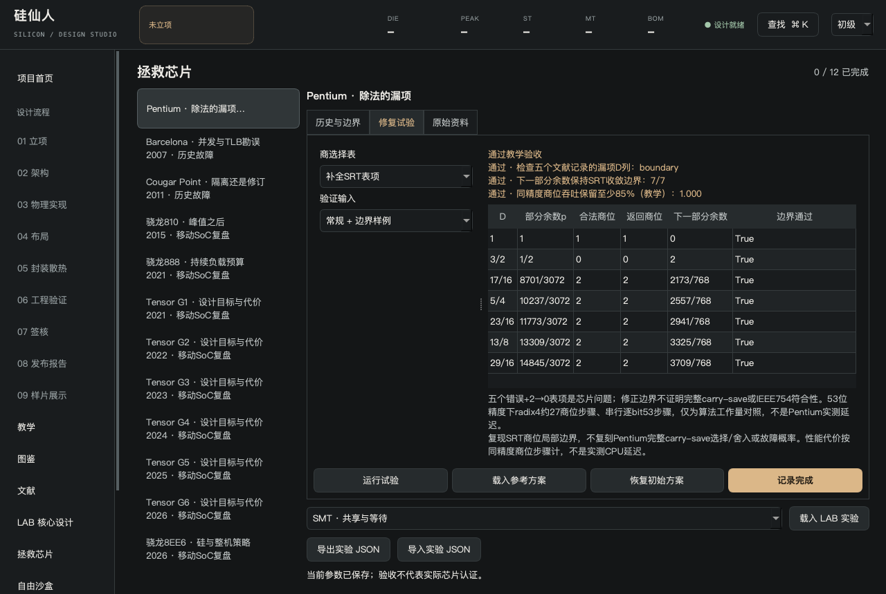
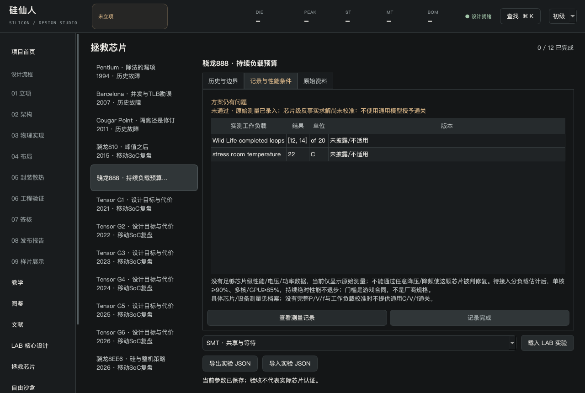

# 拯救芯片：先诊断，再讨论修复

首页或侧栏进入“拯救芯片”。这里的方案和完成进度独立保存，不替换你正在设计的SoC。

## 两种不同的问题

| 档案 | 教学试验关注什么 | 不能据此声称什么 |
| --- | --- | --- |
| Pentium | 商选择漏项、验证覆盖、修订 | 复现原始x87/SRT硬件与故障概率 |
| Barcelona | PTE A/D更新、驱逐、外部探测与缓存旁路代价 | 复现完整TLB电路、MSR或BIOS规避代码 |
| Cougar Point | 风险端口隔离、连接能力与桥接共享带宽 | 已模拟SATA电气层或晶体管老化 |
| 骁龙810、888、8EE6 | 具体芯片架构、设备测量与性能合同；反事实模型待校准 | 通用热模型已拯救真实芯片 |
| Tensor G1–G6 | 各代独立架构、原始工作负载与待补数据 | 整个系列都是失败芯片 |

AMD原厂41322修订指南、Pentium技术论文和HTC M9、Mi11、Pixel6–11原始评测已取得。8EE6对应Snapdragon 8 Elite Extreme Gen6，原厂简报已确认，但社区故障根因仍需独立原始证据。原始评测中的设备、系统、API和测试条件随档案保存。

## 完成一次试验

以下步骤适用于三类已实现的历史故障试验。移动芯片在“记录与性能条件”查看原始测量，当前没有可通关的修复求解器或参考方案。

1. 选一个案例，在“历史与边界”核对对象、来源、设备条件和模型限制。
2. 到“修复试验”运行初始方案，找到未通过项。
3. 改变一项参数，再运行。比较改善与付出的代价。
4. 全部通过后点击“记录完成”。载入参考方案本身不会自动通关。

除法常规向量通过仍可能遗漏边界；串行规避可能让请求完成却损失并发；端口隔离还要检查连接能力。不要只看一个“通过”标记。

## 芯片与设备分开

旧的统一C/V/f热模型已经停用。上图展示当前移动芯片测量档案，不是反事实预测或原芯片设计。没有足够芯片级校准时不能通关。

810档案对应HTC M9的A57/A53与Adreno430，GPU T-Rex可由50fps降到30fps；888档案对应Mi11的X1/A78/A55与Adreno660，22 C的20轮WildLife测试在12–14轮中止。后者缺完整最低分，不能凭一个“稳定率”补齐。

Tensor G1–G6分别保存CPU、GPU、内存与工作负载记录。G5使用PowerVR DXT GPU，不能沿用G4的Mali；G4/G5的图形与OpenCL/Vulkan表现方向不同，不能按统一GPU系数计算。未披露的P/V/f曲线、热阻、固件build不填猜测数值。

基础性能合同建议单核≥原记录90%、多核和GPU峰值≥85%，持续绝对吞吐不退步。性能缩水70%不算修复；把峰值压到很低，让最低/最高比值达到100%，也不算修复。样本缺失时不得默认验收通过。

Pentium实验使用文献中的五个SRT商选择漏项和部分余数收敛边界；不是自造十六进制整数故障。Barcelona实验覆盖PTE A/D更新、驱逐、外部探测与一致性，并展示缓存旁路的工作负载代价；功能完成但吞吐损失过大的方案不能交付。周期与性能门槛仍是教学合同，不是原厂测量。

## Geekbench 6

图鉴与复盘页的GB6实测独立于SP游戏分；保留设备、版本与来源。比如同一原始评测GB6.7表中的G2是1465/3967，不使用同页GB5.5的1048/3222。

Primate Labs定义分项几何平均，再按整数65%/浮点35%汇总。多核采用shared-task，不能将单核×核数。自定义芯片只有整数子集/IPC模型时，GB6不能可靠推算；待有各工作负载的校准结果后才能给估计，且必须标为非官方。没有数据时显示不可估计，不凭SP分数换名字。

## 接着研究资源

底部可载入SMT、MSHR、分支预测或加速器资源实验。它们会建立独立LAB草稿，进入[执行观测](observatory.md)，当前SoC保持不变。

“导出实验JSON”包含参数、结果、案例范围和资料快照；导入只采用可识别参数并重新计算，不相信文件附带的通关标记。它不替代`.sil`或`.cor`，也不包含原芯片设计。
