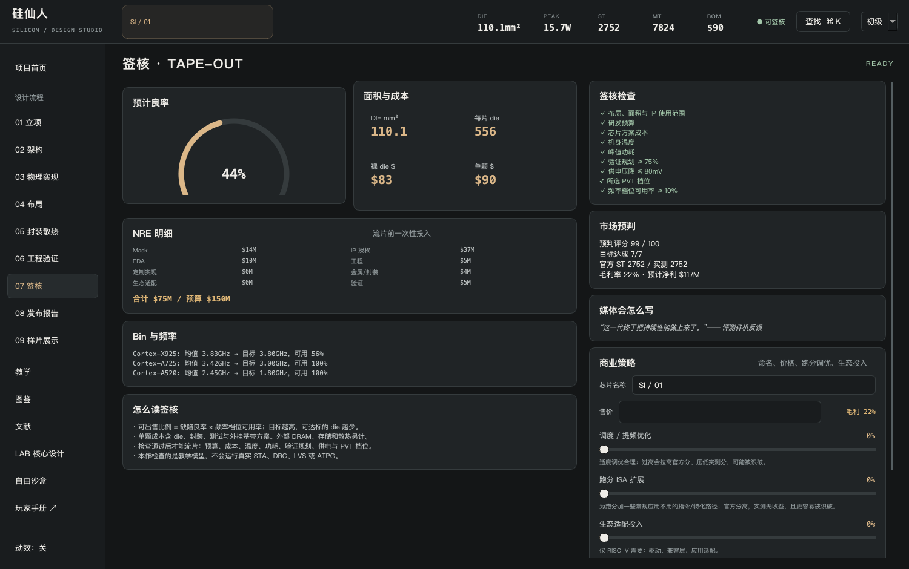

# 文件、备份、更新与分享

## 选择正确的交付文件

| 文件 | 包含内容 | 收到后怎样使用 |
| --- | --- | --- |
| `.sil` | SoC实例、布局、参数、自定义核心、模板核心名称/完整参数与参考制程 | 首页“导入.sil设计” |
| `.cor` | 单个CPU/GPU/NPU/ISP名称、硬件定义、身份与验证记录 | LAB“导入.cor” |
| `.png` | 当前设计的模拟硅片、晶圆或布局图 | 浏览/展示，不能继续编辑芯片 |
| `save.json` | 当前工作方案、草稿、IP库、课程与关卡进度 | 备份和迁移玩家数据 |

`.sil`必须独立携带核心。朋友不需要同时收到每份`.cor`。模板名称与参数也随文件保存，导入优先采用文件快照，避免本机模板版本不同悄悄改变硬件。

## 导出SoC

1. 给芯片命名。
2. 在签核页导出设计，保存为`我的相机芯片.sil`。未签核的合法工作方案也可以导出用于讨论。
3. 在样片展示页导出一张PNG作为预览。
4. 分享`.sil`与PNG，并说明游戏版本、项目、达成的目标及模型限制。



PNG自带模拟生成标记。不要裁掉标记后称它为实物die shot。对于chiplet，图只表示本作逻辑总方案，不能当真实多die显微图。

## 导入朋友的设计

首页“导入.sil设计”打开文件，架构页应显示文件内的核心名称。LAB“已发布IP”中，来自文件的自定义核心标为“当前SoC内嵌”，可以建立可编辑草稿或单独导出`.cor`。

导入覆盖当前SoC工作方案。需要保留自己的版本时先导出；自动存档只保证当前状态，不保存无限历史。

文件的摘要用于发现损坏或内容失配，不能认证厂商资料真实性。导入不执行文件中的代码，不直接信任文件分数；硬件会重新验证，SoC结果重新计算。

## 核心版本与SoC实例

给核心改名或修改硬件后发布，会生成新内容ID。原SoC仍使用已经嵌入的旧资产；若想使用新版，要主动重新实例化或绑定。只改测试汇编/矩阵/校准值不会产生新硬件身份。

相同核心可以多次实例化。一份定义共享给多个实例，实例数量、L2、时钟、实现选项留在SoC里。模板核心是游戏参数快照，不包含厂家RTL。

## 存档、更新与迁移

脚本启动的存档位于项目saves/save.json，包含当前方案、核心草稿、IP库和进度。关闭游戏后备份整个saves目录。只自动保存当前状态，不保留无限设计历史；重要版本另导出.sil/.cor。

更新时下载新源码到新目录，将旧saves复制过去再启动。不要复制旧.venv，脚本会按当前依赖重新创建环境。Windows和Mac之间可传.sil/.cor；也可复制saves/save.json，但必须核对新版模型重算结果。

环境变量SILICON_PROFESSOR_SAVE_DIR可指定独立存档目录，适合多玩家或测试。游戏/文件结构/模型版本分别记录；版本数字不同不单独阻止读取，不可理解的硬件语义仍明确报错。核心快照不冻结运行引擎的全部公式。

## 一份清楚的分享说明

```text
名称：我的影像SoC / 02
游戏版本：0.1.0-alpha.4
项目：相机里的两种算力
核心：我的ISP + 8×8 INT8 NPU，定义已包含在.sil
验收：项目目标与教学签核通过
附件：影像SoC.sil + 模拟布局.png
说明：PPA是游戏估算；无实际RTL/PDK签核
```

如果导入报错，保留原文件，记录完整错误和来源版本，参考[常见问题](faq.md)。不要直接删摘要或改ISA让错误消失，这可能导入成另一个设计。
