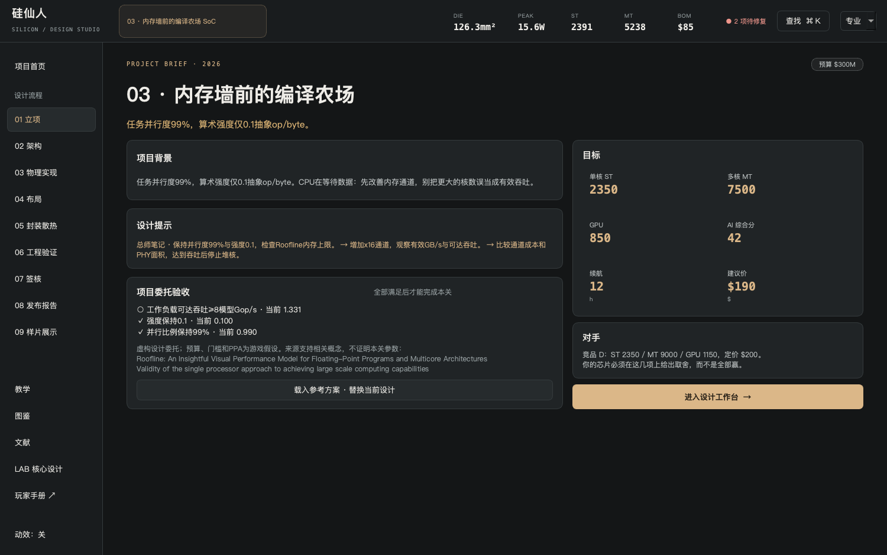
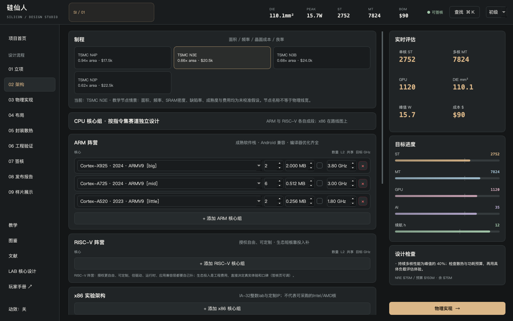
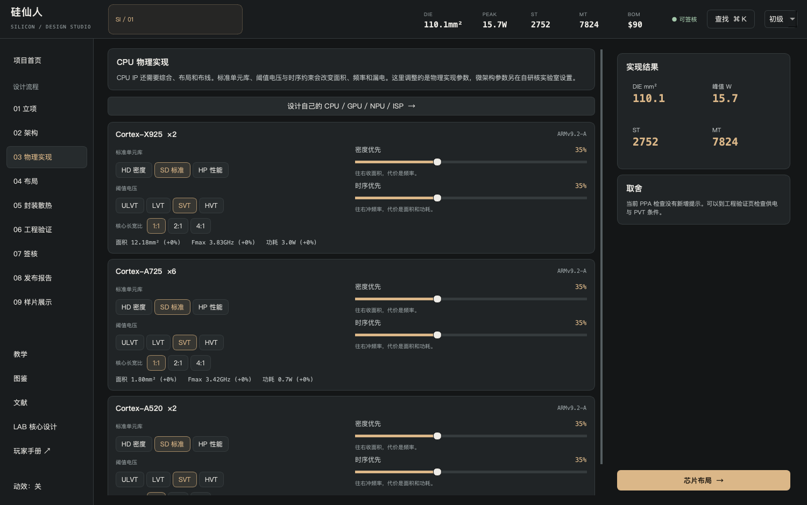
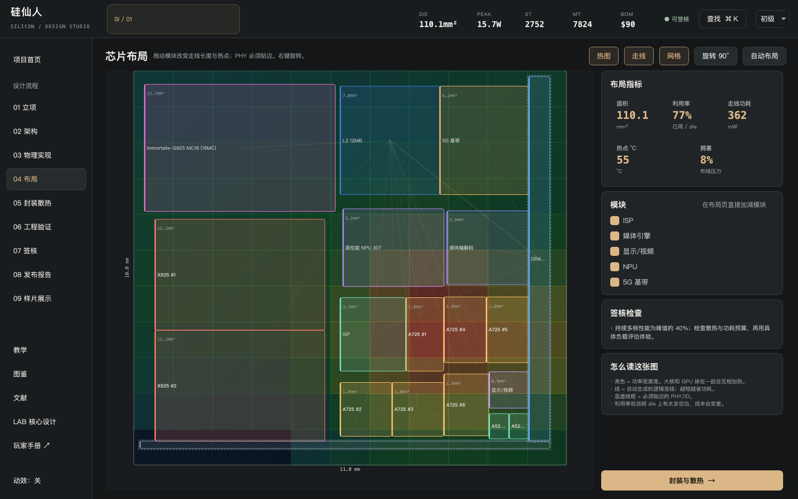
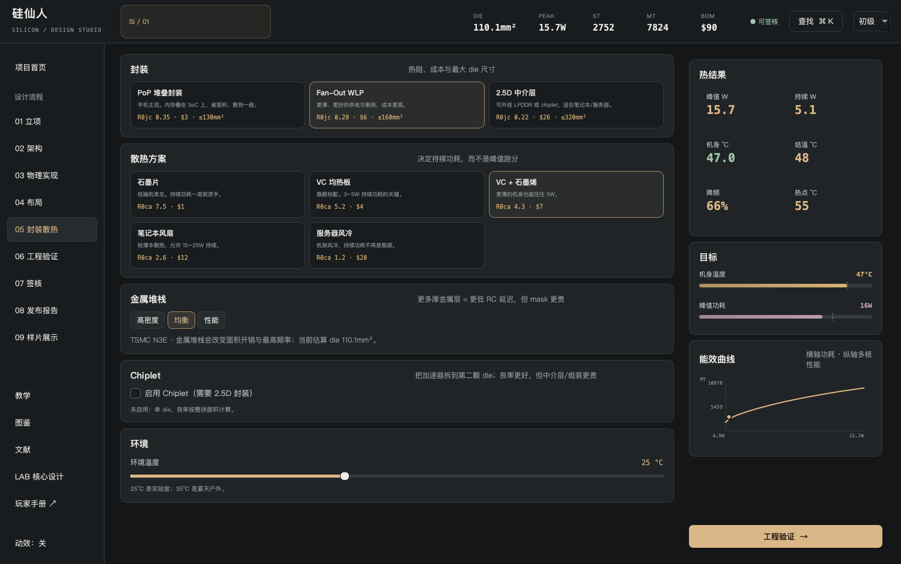
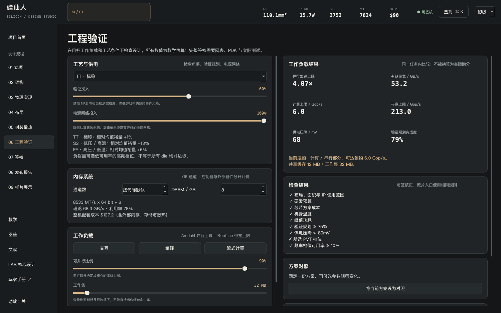
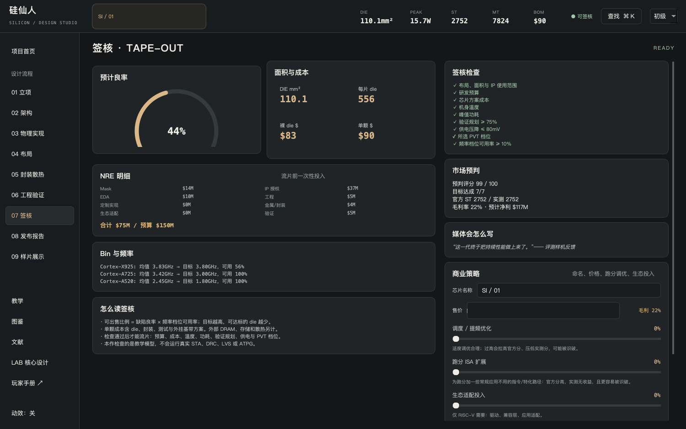
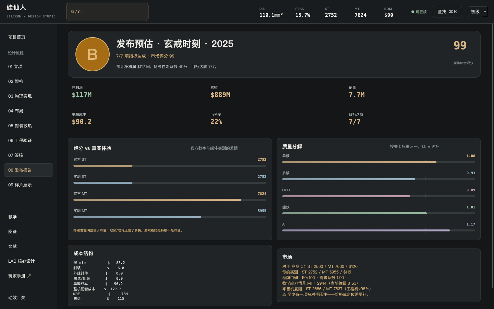
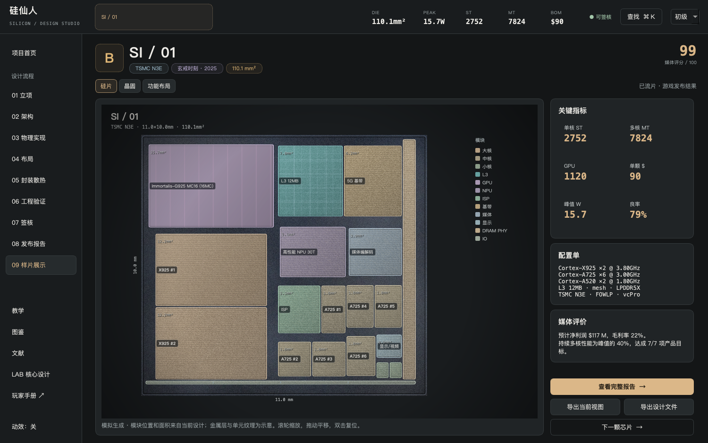

# 第一颗SoC：九个设计阶段

SoC是多个核心、存储、互连和接口共同工作的系统。先确定产品约束，再决定硬件；不要只把最大的模块全部放进去。

## 01 · 立项

首页选择“中端5G”开始自由设计，或选一项挑战委托。简报给出产品背景、预算、参考能力和设计提示。挑战简报另有“项目委托验收”，那里的每一项都必须满足。

初始方案刻意留有问题。修改后的工作方案自动保存；点击“载入参考方案”会替换当前设计，不会保留这一步之前的工作版本，建议先导出自己的`.sil`。

## 02 · 架构

选择制程、CPU组、L2/L3/SLC、NoC、DRAM、GPU、NPU和固定接口。CPU组的数量、L2、目标频率属于实例设置；核心本身的ISA、ALU和队列在LAB设计。

| 选择 | 代价和意义 |
| --- | --- |
| 制程 | 改变面积/频率代理值、光罩与晶圆费用，不能保证越新越便宜 |
| CPU数量 | 并行算力增加，也增加功率/面积；串行程序收益有限 |
| L2/L3/SLC | SRAM占地和功耗，缓存容量不自动等于命中率 |
| GPU规模 | 当前架构的单元数量；不同GPU的MC/Core/Slice不可直接等价 |
| DRAM与通道 | 带宽、PHY和平台费用；GB/s与MT/s使用不同单位 |
| 已保存IP | 在允许自研的项目中选择自己的核心，定制加速器实际绑定会在页面显示 |

自动频率按本模型参考Fmax估算。明确设高频时也必须看PVT余量和bin，不要只读顶部峰值能力。

## 03 · 物理实现

标准单元库HD/SD/HP、阈值电压、密度/时序偏向和模块形状改变本作PPA估算。高性能设置可能同时增加功耗、泄漏和面积。它们是代理值，没有运行真实综合或布局布线。

## 04 · 布局

用自动布局得到起点，再拖动、旋转模块。检查重叠、边界、拥塞和功率密度。将多个高功率模块挤到一处可能增加热点代理值；过多空白也增加die成本。

布局中的矩形是逻辑模块，不是实际标准单元、bump或金属网表。模拟硅片纹理从这些模块生成。

## 05 · 封装与散热

选择适合设备形态的封装和散热。手机项目不能用笔记本或服务器散热器绕过机身约束。环境温度也是输入；固定挑战要求的温度，不能随意改成冷环境完成任务。

Chiplet当前只实现同节点两die与2.5D方案。裸die成本分别计入，再加入组装开销；展示页是逻辑总图，不是实物的多die位置或UCIe链路验证。

## 06 · 工程验证

查看工艺角落、验证规划、电源压降和工作负载。点击“将当前方案设为对照”，再改变一个参数，比较结果。

| 结果 | 怎样读 |
| --- | --- |
| 并行加速上限 | 串行部分限制多核收益；Amdahl不是实测跑分 |
| 计算上限/带宽上限 | 较小一方限制当前抽象任务吞吐 |
| 工作集/缓存容量比 | 是否有容量压力的提示，不能推算真实cache miss |
| 供电压降 | 本作I×R估算，80mV是教学门槛 |
| 验证规划完成度 | 投入代理值，不能当实际代码覆盖率 |
| PVT档位 | 本作相对角落，未跑SPICE/STA |

## 07 · 签核

签核检查包含布局/IP、预算、成本、机身温度、峰值功耗、验证、供电、PVT和频率分档。挑战还检查委托目标。任何一项未通过，流片入口都会保持不可用。

修复顺序建议：先解决结构/IP和非法选择，再解决温度/功耗/压降，再优化成本/能力。降低频率往往同时影响功耗、bin和成本；改变后重新看全部检查。

## 08 · 发布报告

检查预计能力、持续性能、成本、利润和市场评分。未流片方案属于预估；“流片”只是游戏事件，不会联系代工厂。销量和故障事件是游戏规则，不预测真实公司经营或芯片可靠性。

新挑战的完成状态由确定性检查决定，市场成绩可单独比较。记录为什么达成目标，比只追求S级更有用。

## 09 · 样片与分享

在模拟硅片、晶圆与功能布局间切换；滚轮缩放、拖动平移，双击或按0复位。导出PNG用于展示，导出`.sil`用于传递可编辑设计。

PNG是模拟图，不能代替设计文件。朋友需要继续修改时，分享`.sil`；只需要一个核心时分享`.cor`。

继续：[12项设计委托](challenges.md) · [文件与分享](sharing.md)
